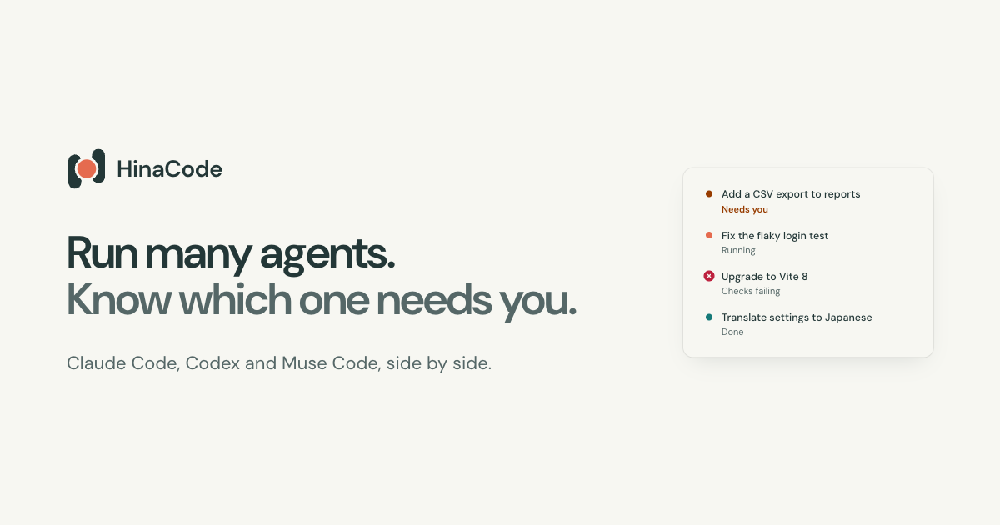

<div align="center">


# HinaCode

**Run many agents. Know which one needs you.**

A delightful workstation for running Claude Code, Codex, Muse Code, and opencode in parallel, each in its own worktree, each visible at a glance.

[](https://github.com/hinadev-ai/hinacode/actions/workflows/ci.yml)
[](https://github.com/hinadev-ai/hinacode/actions/workflows/build.yml)
[](https://github.com/hinadev-ai/hinacode/releases/latest)
[](https://github.com/hinadev-ai/hinacode/releases)
[](LICENSE)
[](#download)
[](https://github.com/hinadev-ai/hinacode/stargazers)

[Download](https://github.com/hinadev-ai/hinacode/releases/latest) · [Documentation](docs/README.md) · [Report a bug](https://github.com/hinadev-ai/hinacode/issues/new) · [Request a feature](https://github.com/hinadev-ai/hinacode/issues/new) · [Releases](https://github.com/hinadev-ai/hinacode/releases)

**English** · [繁體中文](README.zh-TW.md)

</div>

<!-- Replace with a product screenshot or short demo GIF -->
<!-- <p align="center"></p> -->
<p align="center">
  
</p>

> [!WARNING]
> HinaCode is in alpha and ships several times a day. Expect bugs, and please [report them](https://github.com/hinadev-ai/hinacode/issues).

---

## Why HinaCode?

Running one agent in a terminal works. Running five stops working: you lose track of which checkout each agent owns, which one is waiting for approval, and which pull request each one shipped.

HinaCode is a **delightful workstation for coding agents**. It handles the work around each agent: where it runs, when it needs you, what it changed, and how it ships. That way you can run agents in parallel and stay in control.

- **Free and open source** under the MIT license. No markup, no proxy.
- **Uses the agents you already pay for.** HinaCode runs the `claude`, `codex`, `muse`, and `opencode` CLIs you are signed in to. Usage goes to those plans or API keys, exactly as it does in a terminal.
- **Local by default.** Your code only goes where those CLIs already send it. HinaCode keeps its data in a single SQLite file on your machine.
- **Built with HinaCode, every day.** If the workflow hurts, we feel it first.

---

## Features

- **A worktree per thread.** Branch from `main`, any branch, or an open pull request. Your setup script runs before the agent starts.
- **Four agents, one sidebar.** Pick Claude Code, Codex, Muse Code, or opencode per thread, and switch mid-thread.
- **Inbox.** Every active thread in one list, with approvals and questions marked.
- **Inline approvals and questions.** Allow, deny with a note, or answer without leaving the thread.
- **Steer or queue.** Change the agent's course mid-turn, or queue the next task behind it.
- **Diffs per turn.** Comment on a line and the agent gets the exact spot.
- **Browser, terminal, and ports.** Open the dev server, a shell, and the ports an agent left open beside the thread.
- **Linked pull requests.** See checks and review state next to the thread. HinaCode tells the agent when checks fail or a review lands.
- **Merge and clean up.** Squash and merge from the thread, and HinaCode removes the worktree.
- **Automations.** Start a thread from a webhook, a GitHub issue, a Linear ticket, or a Slack mention.
- **Built-in MCP server.** Agents can ask you for secrets, hand work to other threads, drive a disposable VM or mobile simulators, and use Linear.
- **Remote machines and your phone.** Run `npx hinacode serve` on another machine, then approve, steer, and merge from the phone app.

---

## Supported agents

Install each CLI you want to use, sign in, and keep it on your `PATH`. HinaCode never sits between you and the provider.

| Agent                                                 | CLI        | Sign in                          | Protocol                    |
| ----------------------------------------------------- | ---------- | -------------------------------- | --------------------------- |
| [Claude Code](https://claude.com/product/claude-code) | `claude`   | `claude` (follow the login flow) | Agent SDK                   |
| [Codex](https://openai.com/codex/)                    | `codex`    | `codex` (follow the login flow)  | App-server protocol         |
| Muse Code                                             | `muse`     | `muse login`                     | MSP                         |
| [opencode](https://opencode.ai)                       | `opencode` | `opencode auth login`            | Agent Client Protocol (ACP) |

Adding a backend takes one `AgentProvider` implementation in `src/main/agents/` plus registration in the runner. See the [agent provider guide](docs/agent-providers.md).

---

## Download

Download the latest build for your platform from [**Releases**](https://github.com/hinadev-ai/hinacode/releases/latest):

| Platform              | Format    |
| --------------------- | --------- |
| macOS (Apple silicon) | `.dmg`    |
| Windows               | Installer |
| Linux                 | AppImage  |

The headless server runs anywhere Node 24 does (see [Remote and headless](#remote-and-headless)).

---

## Quick start

1. **Install and sign in to at least one agent CLI.** See [Supported agents](#supported-agents).
2. **Download and open HinaCode.**
3. **Add a project.** Pick a local repository, or create one from GitHub.
4. **Start a thread.** Choose an agent and a model, write a prompt, and send it. HinaCode creates a worktree, runs your setup script, and starts the agent.
5. **Watch the sidebar.** Answer approvals and questions in place, review the diff, and merge the pull request from the thread when it is green.

> Importing a project trusts it: its `.claude` settings, hooks, and `CLAUDE.md` load the same way they do in the CLI. See [ADR 0008](docs/adr/0008-import-trusts-the-project.md).

---

## Remote and headless

Run HinaCode as a headless daemon on another machine, then drive it from your desktop or phone:

```sh
npx hinacode serve
```

The daemon prints pairing URLs on startup. Add the machine in **Settings** on the desktop, or scan the QR code with the phone app. It keeps its own data directory (`~/.hinacode-cloud` by default, override with `HINACODE_USER_DATA`) and therefore its own projects and threads.

---

## Development

### Prerequisites

- **Node** 24.22.1 or later (26.12.1 or later on Node 26) and **pnpm**
- The agent CLIs you want to run (`claude`, `codex`, `muse`, and/or `opencode`), signed in and on your `PATH`
- **ripgrep** (`rg`) on your `PATH`, for global file search and its integration tests
- Chrome or Chromium, only for Remote Browser tabs and their integration tests (`pnpm exec playwright install --with-deps chromium`)

### Run it locally

```sh
pnpm install
pnpm dev
```

### Common commands

```sh
pnpm build        # bundle main, preload, and renderer into out/
pnpm build:server # bundle only the headless daemon into out/server/
pnpm dev:remote   # headless dev app with DevTools on http://<tailscale-ip>:9333
pnpm typecheck    # tsrs over the node, web, web-test, e2e, and scripts configs
pnpm lint         # oxlint (run `pnpm lint --fix` to sort Tailwind classes)
pnpm format       # oxfmt, no semicolons, width 120
pnpm test         # unit + integration (Vitest)
pnpm test:e2e     # Playwright + Gherkin scenarios against the built Electron app
pnpm check:specs  # TLC over specs/*.cfg (needs Java 11+)
```

Run `pnpm typecheck && pnpm lint && pnpm test` before you call work done. CI runs the same checks on every pull request, plus `pnpm test:e2e` on `ubuntu-latest`.

Run a built app with its own data directory, for example to keep a test profile apart from your real one:

```sh
HINACODE_USER_DATA=/tmp/hinacode-test pnpm exec electron out/main/index.js
```

Unpackaged runs (`pnpm dev`, e2e, and the command above) never touch the login Keychain. They seal secrets with Chromium's public mock key, so save only dummy secrets in them. Without `HINACODE_USER_DATA` they use `~/.hinacode-dev`, not the release app's `~/.hinacode`. A data directory holds the database, `chats/`, and `attachments/` at the top and Chromium's profile in `chromium/`.

<details>
<summary><b>Testing</b></summary>

| Command                 | What runs                                                                                                                                                      |
| ----------------------- | -------------------------------------------------------------------------------------------------------------------------------------------------------------- |
| `pnpm test:unit`        | Vitest, in-process: pure helpers, stores, event mapping. Files named `*.test.ts`.                                                                              |
| `pnpm test:integration` | Vitest against real SQLite files, git, child processes, and the MCP HTTP server. Files named `*.integration.test.ts`.                                          |
| `pnpm test`             | Both Vitest projects.                                                                                                                                          |
| `pnpm test:e2e`         | Playwright drives the built Electron app through Gherkin scenarios in `e2e/features`. Needs a display: `DISPLAY` or an `Xvfb :99`, or run under `xvfb-run -a`. |

Effect code is tested with `@effect/vitest`: `it.effect` runs under the test clock, `it.live` on the real one, and `layer(...)` shares a built layer across a block. Every e2e worker starts its own HinaCode on a throwaway `HINACODE_USER_DATA`, seeds preconditions through `window.hinacode.rpc` or straight into SQLite, and drives the behavior under test through the UI.

Remote Browser tabs and their integration tests need Chrome or Chromium on the host. To install Playwright's Chromium and its Linux dependencies, run `pnpm exec playwright install --with-deps chromium`. A cloud installed from npm can use `npx playwright install --with-deps chromium`. Set `HINACODE_BROWSER_EXECUTABLE_PATH` when the browser lives elsewhere. The browser runs on the thread's machine, so its `localhost` reaches that machine's services.

Scenarios that depend on native pointer capture, scrolling, or window focus carry `@desktop`. They run with one worker after the parallel scenarios finish, because separate app profiles still share the desktop's focus and input. Run selected desktop scenarios with `pnpm test:e2e --project desktop --no-deps -g 'Resizable'`.

Tests never wait on wall-clock timers; oxlint rejects `setTimeout`, `setInterval`, and the `timers` modules in test files. Wait on the thing itself instead: a push event, a `PubSub` the service publishes to, a file change, a Playwright locator assertion, or `TestClock.adjust` for code that sleeps. The verification skill in `.agents/skills/verify-hinacode` picks up where e2e stops: real agent turns, GitHub through `gh`, and native dialogs.

</details>

<details>
<summary><b>Simulate limits and verify headlessly</b></summary>

Simulate an exhausted Claude account without using the account:

```sh
HINACODE_USER_DATA=/tmp/kk-limit-demo HINACODE_MOCK_CLAUDE=usage-limit pnpm dev
```

The first message in each thread reaches the limit. The next attempt succeeds. The callout offers **Resume at reset**, which retries once at the provider's reset time and survives restart. Set `HINACODE_MOCK_RESET_MS=5000` for a five-second reset. Use `HINACODE_MOCK_CLAUDE=org-spend-limit` to simulate the organization monthly spend cap and its `/usage-credits` guidance. That case has no automatic reset action. See [docs/operations/mock-claude.md](docs/operations/mock-claude.md) for the other scenarios, each one `/mock-<scenario>` message away.

Headless verification on a machine without a display uses Xvfb and Chrome DevTools:

```sh
Xvfb :99 -screen 0 1600x1000x24 &
HINACODE_USER_DATA=/tmp/hinacode-test DISPLAY=:99 pnpm exec electron --no-sandbox --disable-gpu --remote-debugging-port=9222 out/main/index.js
```

To verify in the real app, use the `verify-hinacode` skill (`.agents/skills/verify-hinacode/`), which launches an isolated instance over Xvfb and CDP and drives it with screenshots. To stress-test the UI with worst-case data (long names, RTL text, missing files, huge lists), start with `scripts/break-ui/launch.sh` instead. See `scripts/break-ui/README.md`.

</details>

---

## Architecture

HinaCode is an Electron app. The main process runs the agents, the React renderer talks to it over one `rpc` channel, and everything durable lives in one SQLite file. The same main process runs headless as `hinacode serve`. See [docs/arch.md](docs/arch.md) for diagrams and [docs/adr/](docs/adr/) for the decisions behind them.

---

## Contributing

Contributions are welcome. Read [AGENTS.md](AGENTS.md) first, then:

- Name branches `feat/*` or `fix/*`, and write [Conventional Commits](https://www.conventionalcommits.org/) with a scope.
- Write a design in `docs/features/` before a non-trivial feature, and a failing test before a bug fix.
- Run `pnpm typecheck && pnpm lint && pnpm test` before you open a pull request.

---

## FAQ

**What does HinaCode cost?**
Nothing. Every feature is free, and the code is open source under the MIT license.

**Which agents does it run?**
Claude Code, Codex, Muse Code, and opencode. Install each CLI you want to use and sign in to it.

**Does my code leave my machine?**
Only where the agent CLIs already send it. HinaCode runs locally and keeps its data in a SQLite file on your machine.

**Is it ready for daily use?**
It is in alpha. We build HinaCode with HinaCode every day, and new versions ship several times a day. Expect bugs, and report them on GitHub.

**Which platforms are supported?**
macOS on Apple silicon, Windows, and Linux as an AppImage. The server runs anywhere Node 24 does.

---

## Security

HinaCode runs agents that execute code on your machine, so a few boundaries are held firmly:

- The renderer is sandboxed, and only the top-level app frame may call `rpc`.
- `shell.openExternal` only opens `http(s)` URLs.
- The MCP server listens on loopback only, and its credential scopes each call to one thread.
- Webhooks require an HMAC signature, checked with `timingSafeEqual`.
- The attachment protocol refuses paths outside its root.
- Secrets go through `services/Secrets.ts`, sealed by the OS keyring. They are never logged, put in a URL, or sent to the renderer.

This is a single-user local app by design: no RBAC, audit logs, or extra encryption layers on top of the OS keyring.

---

## Acknowledgements

Several designs in HinaCode follow [T3 Code](https://github.com/pingdotgg/t3code) (MIT, copyright 2026 T3 Tools Inc.), reimplemented here rather than copied:

- Effect services as `Context.Service` classes with a `make` effect and a `layer` export, and migrations registered through `Migrator.fromRecord`.
- The MCP server design: Effect's `McpServer.layerHttp` behind a bearer credential, one random credential per thread, injected into the agent's MCP config. The pull request tools (`link_pull_request`, `unlink_pull_request`, `list_thread_pull_requests`) and `request_secret` share T3 Code's names.
- The pull request checks rollup: `null` when a PR has no checks, failing before pending before passing, and `workflow / name` as the check label.
- Webhook automations verified with a `sha256=` HMAC in `x-hub-signature-256`, with `{{path}}` placeholders filled into the prompt.
- Remote browser tabs run headless Chromium on the thread's host and send screencasts to the client. We compared Orca's local network proxy and server streaming before choosing this design for the Node daemon. See [the remote browser design](docs/features/2026-10-26-remote-browser.md).

---

## License

[MIT](LICENSE) © 2026 Kalan

<div align="center">
  <sub>Built with HinaCode.</sub>
</div>
