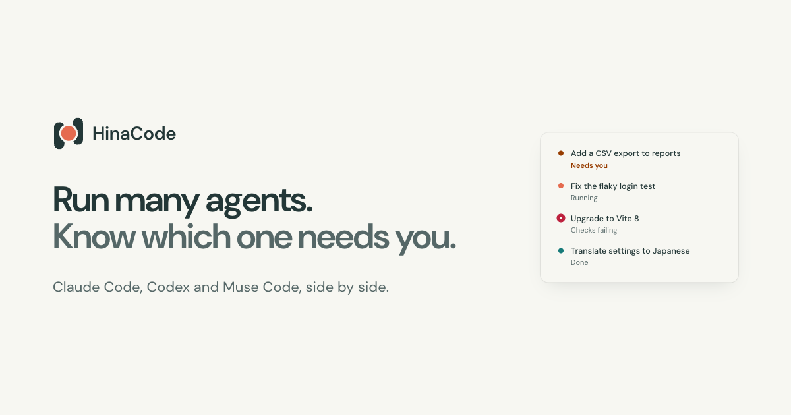

<div align="center">


# HinaCode

**同時執行多個代理，隨時知道誰需要你。**

一個令人愉悅的工作站，讓你平行執行 Claude Code、Codex、Muse Code 和 opencode，每個代理都在自己的工作樹中，狀態一目瞭然。

[](https://github.com/hinadev-ai/hinacode/actions/workflows/ci.yml)
[](https://github.com/hinadev-ai/hinacode/actions/workflows/build.yml)
[](https://github.com/hinadev-ai/hinacode/releases/latest)
[](https://github.com/hinadev-ai/hinacode/releases)
[](LICENSE)
[](#下載)
[](https://github.com/hinadev-ai/hinacode/stargazers)

[下載](https://github.com/hinadev-ai/hinacode/releases/latest) · [說明文件](docs/README.md) · [報告 bug](https://github.com/hinadev-ai/hinacode/issues/new) · [功能請求](https://github.com/hinadev-ai/hinacode/issues/new) · [版本發布](https://github.com/hinadev-ai/hinacode/releases)

[English](README.md) · **繁體中文**

</div>

<!-- 替換為產品截圖或簡短的示範 GIF -->
<!-- <p align="center"></p> -->
<p align="center">
  
</p>

> [!WARNING]
> HinaCode 仍處於 alpha 階段，每天會發布多個版本。請做好遇到 bug 的準備，並[向我們報告](https://github.com/hinadev-ai/hinacode/issues)。

---

## 為什麼選擇 HinaCode？

在終端機裡跑一個代理沒問題。跑五個就不行了：你分不清每個代理用的是哪個檢出目錄，哪個正在等待核准，以及各自交付了哪個合併請求。

HinaCode **是一個令人愉悅的程式碼代理工作站**。它負責每個代理周邊的工作：在哪裡執行、何時需要你、改動了什麼、如何交付，讓你能平行執行代理並始終保持掌控。

- **免費且開源**，採用 MIT 授權條款。不額外加價，也不經手轉送。
- **使用你已經付費的代理。** HinaCode 執行你已登入的 `claude`、`codex`、`muse` 和 `opencode` CLI。用量計入對應的訂閱方案或 API 金鑰，和在終端機裡使用時完全一樣。
- **預設本機執行。** 你的程式碼只會發往這些 CLI 本來就會傳送的地方。HinaCode 把資料儲存在你機器上的單一 SQLite 檔案中。
- **每天用 HinaCode 打造 HinaCode。** 如果工作流程讓人難受，我們最先感受到。

---

## 功能

- **每個對話串一個工作樹。** 從 `main`、任意分支或開啟中的合併請求建立分支。你的設定腳本會在代理啟動前執行。
- **四個代理，一個側邊欄。** 為每個對話串選擇 Claude Code、Codex、Muse Code 或 opencode，也能在中途切換。
- **收件匣。** 所有進行中的對話串集中在一份清單裡，需要核准的事項和問題都會被標記。
- **行內核准與提問。** 允許、附上說明後拒絕，或直接回答，不必離開對話串。
- **引導或排入佇列。** 在回合中途改變代理的方向，或把下一個任務排在後面。
- **每一輪的差異。** 在某一行留言，代理就知道確切位置。
- **瀏覽器、終端機與連接埠。** 在對話串旁開啟開發伺服器、shell，以及代理留下的連接埠。用 `@` 提及終端機，或把選取的輸出傳送到對話串，代理就會讀取它。
- **關聯的合併請求。** 在對話串旁查看檢查和審查狀態。檢查失敗或收到審查意見時，HinaCode 會通知代理。
- **合併與清理。** 從對話串中 squash 並合併，HinaCode 會移除工作樹。
- **自動化。** 由 webhook、GitHub issue、Linear Issue 或 Slack 提及來啟動對話串。
- **內建 MCP 伺服器。** 代理可以向你索取密鑰、把工作交給其他對話串、操作臨時虛擬機器或行動裝置模擬器，以及使用 Linear。
- **遠端機器與手機。** 在其他機器上執行 `npx hinacode serve`，再用手機應用程式核准、引導和合併。

---

## 支援的代理

安裝你想使用的每個 CLI，登入，並確保它在你的 `PATH` 中。HinaCode 絕不會夾在你和供應商之間。

| 代理                                                  | CLI        | 登入                       | 協定                        |
| ----------------------------------------------------- | ---------- | -------------------------- | --------------------------- |
| [Claude Code](https://claude.com/product/claude-code) | `claude`   | `claude`（依登入流程操作） | Agent SDK                   |
| [Codex](https://openai.com/codex/)                    | `codex`    | `codex`（依登入流程操作）  | App-server protocol         |
| Muse Code                                             | `muse`     | `muse login`               | MSP                         |
| [opencode](https://opencode.ai)                       | `opencode` | `opencode auth login`      | Agent Client Protocol (ACP) |

新增一個後端只需在 `src/main/agents/` 中實作一個 `AgentProvider`，並在 runner 中註冊。參閱[代理供應商指南](docs/agent-providers.md)。

---

## 下載

從 [**Releases**](https://github.com/hinadev-ai/hinacode/releases/latest) 下載適用於你平台的最新版本：

| 平台                | 格式     |
| ------------------- | -------- |
| macOS（Apple 晶片） | `.dmg`   |
| Windows             | 安裝程式 |
| Linux               | AppImage |

無介面伺服器可在任何支援 Node 24 的地方執行（參閱[遠端與無介面執行](#遠端與無介面執行)）。

---

## 快速開始

1. **安裝並登入至少一個代理 CLI。** 參閱[支援的代理](#支援的代理)。
2. **下載並開啟 HinaCode。**
3. **新增專案。** 選擇一個本機儲存庫，或從 GitHub 建立一個。
4. **啟動對話串。** 選擇代理和模型，撰寫提示詞並傳送。HinaCode 會建立工作樹、執行你的設定腳本並啟動代理。
5. **關注側邊欄。** 就地回答核准請求和問題，審查差異，並在檢查全部通過後，直接從對話串合併。

> 匯入專案即表示信任它：它的 `.claude` 設定、hooks 和 `CLAUDE.md` 會像在 CLI 中一樣被載入。參閱 [ADR 0008](docs/adr/0008-import-trusts-the-project.md)。

---

## 遠端與無介面執行

在另一台機器上以無介面常駐程式執行 HinaCode，然後從桌面或手機操作它：

```sh
npx hinacode serve
```

常駐程式啟動時會列印配對 URL。在桌面的**設定**中新增該機器，或用手機應用程式掃描 QR code。它維護自己的資料目錄（預設為 `~/.hinacode-cloud`，可用 `HINACODE_USER_DATA` 覆寫），因此也有自己的專案和對話串。

---

## 開發

### 前置要求

- **Node** 24.22.1 或更高版本（在 Node 26 上需 26.12.1 或更高版本）以及 **pnpm**
- 你想執行的代理 CLI（`claude`、`codex`、`muse` 和/或 `opencode`），已登入並在你的 `PATH` 中
- **ripgrep**（`rg`）在你的 `PATH` 中，用於全域檔案搜尋及其整合測試
- Chrome 或 Chromium，僅用於遠端瀏覽器標籤頁及其整合測試（`pnpm exec playwright install --with-deps chromium`）

### 本機執行

```sh
pnpm install
pnpm dev
```

### 常用指令

```sh
pnpm build        # bundle main, preload, and renderer into out/
pnpm build:server # bundle only the headless daemon into out/server/
pnpm dev:remote   # headless dev app with DevTools on http://<tailscale-ip>:9333
pnpm typecheck    # tsrs over the node, web, web-test, e2e, and scripts configs
pnpm lint         # oxlint (run `pnpm lint --fix` to sort Tailwind classes)
pnpm format       # oxfmt, no semicolons, width 120
pnpm test         # unit + integration (Vitest)
pnpm test:e2e     # Playwright + Gherkin scenarios against the built Electron app
pnpm check:specs  # TLC over specs/*.cfg (needs Java 11+)
```

在宣布完成之前，執行 `pnpm typecheck && pnpm lint && pnpm test`。CI 會在每個合併請求上執行相同的檢查，並在 `ubuntu-latest` 上額外執行 `pnpm test:e2e`。

使用獨立的資料目錄執行建置好的應用程式，例如讓測試設定檔與實際設定檔分開：

```sh
HINACODE_USER_DATA=/tmp/hinacode-test pnpm exec electron out/main/index.js
```

未打包執行（`pnpm dev`、e2e 以及上面的指令）絕不會存取登入鑰匙圈。它們使用 Chromium 的公開模擬金鑰封存密鑰，因此其中只應存放無用的測試密鑰。若不設定 `HINACODE_USER_DATA`，它們會使用 `~/.hinacode-dev`，而不是正式版應用程式的 `~/.hinacode`。資料目錄頂層包含資料庫、`chats/` 和 `attachments/`，Chromium 的設定檔則位於 `chromium/`。

<details>
<summary><b>測試</b></summary>

| 指令                    | 執行內容                                                                                                                                           |
| ----------------------- | -------------------------------------------------------------------------------------------------------------------------------------------------- |
| `pnpm test:unit`        | Vitest，行程內執行：純函式輔助工具、store、事件對應。檔名為 `*.test.ts`。                                                                          |
| `pnpm test:integration` | Vitest，針對真實的 SQLite 檔案、git、子行程和 MCP HTTP 伺服器執行。檔名為 `*.integration.test.ts`。                                                |
| `pnpm test`             | 兩個 Vitest 專案。                                                                                                                                 |
| `pnpm test:e2e`         | Playwright 透過 `e2e/features` 中的 Gherkin 場景驅動建置好的 Electron 應用程式。需要顯示環境：`DISPLAY` 或 `Xvfb :99`，或在 `xvfb-run -a` 下執行。 |

Effect 程式碼使用 `@effect/vitest` 測試：`it.effect` 在測試時鐘下執行，`it.live` 使用真實時鐘，`layer(...)` 在同一個區塊內共享已建置的 layer。每個 e2e worker 都會在臨時 `HINACODE_USER_DATA` 上啟動自己的 HinaCode，透過 `window.hinacode.rpc` 或直接寫入 SQLite 來準備前置條件，並透過 UI 驅動待測行為。

遠端瀏覽器標籤頁及其整合測試需要主機上安裝 Chrome 或 Chromium。若要安裝 Playwright 的 Chromium 及其 Linux 相依套件，請執行 `pnpm exec playwright install --with-deps chromium`。從 npm 安裝的雲端版本可以使用 `npx playwright install --with-deps chromium`。當瀏覽器位於其他位置時，請設定 `HINACODE_BROWSER_EXECUTABLE_PATH`。瀏覽器會在對話串所在的機器上執行，因此它的 `localhost` 會連到該機器上的服務。

需要原生指標擷取、捲動或視窗焦點的場景帶有 `@desktop` 標記。它們會在平行場景完成後以單一 worker 執行，因為不同的應用程式設定檔仍然共用桌面的焦點和輸入。可用 `pnpm test:e2e --project desktop --no-deps -g 'Resizable'` 執行選定的桌面場景。

測試從不等待實際時鐘計時器；oxlint 會拒絕測試檔案中的 `setTimeout`、`setInterval` 和 `timers` 模組。改為等待事物本身：push 事件、服務發布到的 `PubSub`、檔案變更、Playwright 定位器斷言，或針對會休眠的程式碼使用 `TestClock.adjust`。`.agents/skills/verify-hinacode` 中的驗證技能承接 e2e 無法覆蓋的部分：真實的代理回合、透過 `gh` 存取 GitHub，以及原生對話框。

</details>

<details>
<summary><b>模擬限額並進行無介面驗證</b></summary>

在不消耗帳戶的情況下模擬 Claude 帳戶額度耗盡：

```sh
HINACODE_USER_DATA=/tmp/kk-limit-demo HINACODE_MOCK_CLAUDE=usage-limit pnpm dev
```

每個對話串中的第一則訊息會達到用量上限。下一次嘗試會成功。提示橫幅會提供**重設後繼續**，它會在供應商的重設時間重試一次，並在重新啟動後仍然有效。設定 `HINACODE_MOCK_RESET_MS=5000` 可將重設時間設為五秒。使用 `HINACODE_MOCK_CLAUDE=org-spend-limit` 模擬組織的每月支出上限及其 `/usage-credits` 指引。這種情況沒有自動重設動作。其他場景請參閱 [docs/operations/mock-claude.md](docs/operations/mock-claude.md)，每個場景只要傳送一則 `/mock-<scenario>` 訊息即可觸發。

在沒有顯示器的機器上進行無介面驗證，需要使用 Xvfb 和 Chrome DevTools：

```sh
Xvfb :99 -screen 0 1600x1000x24 &
HINACODE_USER_DATA=/tmp/hinacode-test DISPLAY=:99 pnpm exec electron --no-sandbox --disable-gpu --remote-debugging-port=9222 out/main/index.js
```

要在真實應用程式中驗證，請使用 `verify-hinacode` 技能（`.agents/skills/verify-hinacode/`），它會透過 Xvfb 和 CDP 啟動隔離的執行個體，並以截圖驅動它。若要用最壞情況的資料對 UI 做壓力測試（超長名稱、RTL 文字、缺少檔案、超大清單），請改用 `scripts/break-ui/launch.sh` 啟動。參閱 `scripts/break-ui/README.md`。

</details>

---

## 架構

HinaCode 是一個 Electron 應用程式。主行程執行代理，React 渲染行程透過單一 `rpc` 通道與它通訊，所有持久化資料都存放在一個 SQLite 檔案中。同一個主行程也能以 `hinacode serve` 無介面執行。圖解請參閱 [docs/arch.md](docs/arch.md)，背後的決策請參閱 [docs/adr/](docs/adr/)。

---

## 貢獻

歡迎貢獻。請先閱讀 [AGENTS.md](AGENTS.md)，然後：

- 分支命名為 `feat/*` 或 `fix/*`，提交遵循帶有 scope 的 [Conventional Commits](https://www.conventionalcommits.org/)。
- 實作較複雜的功能前，先在 `docs/features/` 寫設計；修正 bug 前，先寫一個會失敗的測試。
- 開啟合併請求前，執行 `pnpm typecheck && pnpm lint && pnpm test`。

---

## 常見問題

**HinaCode 收費嗎？**
不收費。所有功能都免費，程式碼以 MIT 授權條款開源。

**它能執行哪些代理？**
Claude Code、Codex、Muse Code 和 opencode。安裝你想使用的每個 CLI 並登入。

**我的程式碼會離開我的機器嗎？**
只會發往這些代理 CLI 本來就會傳送的地方。HinaCode 在本機執行，資料儲存在你機器上的 SQLite 檔案中。

**它適合日常使用嗎？**
它處於 alpha 階段。我們每天用 HinaCode 打造 HinaCode，新版本每天會發布多次。請做好遇到 bug 的準備，並在 GitHub 上報告。

**支援哪些平台？**
Apple 晶片上的 macOS、Windows，以及以 AppImage 形式提供的 Linux。伺服器可在任何支援 Node 24 的地方執行。

---

## 安全

由於 HinaCode 的代理會在你的機器上執行程式碼，因此有幾條邊界必須嚴格守住：

- 渲染行程處於沙箱中，只有頂層應用程式框架可以呼叫 `rpc`。
- `shell.openExternal` 只會開啟 `http(s)` URL。
- MCP 伺服器只在回送位址上監聽，其憑證會將每次呼叫限定在一個對話串內。
- Webhook 要求 HMAC 簽章，並使用 `timingSafeEqual` 驗證。
- 附件協定會拒絕其根目錄之外的路徑。
- 密鑰透過 `services/Secrets.ts` 處理，由作業系統鑰匙圈封存。它們絕不會寫入日誌、放進 URL 或傳送給渲染行程。

依設計，這是一個單一使用者的本機應用程式：沒有 RBAC、稽核日誌，也沒有在作業系統鑰匙圈之上額外加一層加密。

---

## 致謝

HinaCode 中的若干設計參考了 [T3 Code](https://github.com/pingdotgg/t3code)（MIT，著作權所有 2026 T3 Tools Inc.），在此重新實作而非直接複製：

- 將 Effect 服務實作為 `Context.Service` 類別，帶有 `make` effect 和 `layer` 匯出，並透過 `Migrator.fromRecord` 註冊遷移。
- MCP 伺服器設計：把 Effect 的 `McpServer.layerHttp` 放在 bearer 憑證之後，每個對話串使用一個隨機憑證，並注入代理的 MCP 設定中。合併請求工具（`link_pull_request`、`unlink_pull_request`、`list_thread_pull_requests`）和 `request_secret` 沿用 T3 Code 的命名。
- 合併請求檢查彙整：PR 沒有檢查時為 `null`，優先順序為失敗先於等待中，等待中先於通過，並以 `workflow / name` 作為檢查標籤。
- Webhook 自動化會驗證 `x-hub-signature-256` 中的 `sha256=` HMAC，並把 `{{path}}` 預留位置填入提示詞。
- 遠端瀏覽器標籤頁會在對話串所在的主機上執行無介面 Chromium，並向用戶端傳送螢幕串流。在為 Node 常駐程式選定這個設計之前，我們比較過 Orca 的本機網路代理與伺服器串流。參閱[遠端瀏覽器設計](docs/features/2026-10-26-remote-browser.md)。

---

## 授權條款

[MIT](LICENSE) © 2026 Kalan

<div align="center">
  <sub>使用 HinaCode 建置。</sub>
</div>
