# Architecture

hinacode is one Electron app with three processes: the renderer, the preload, and the main process. The main process runs the agents. It talks to Codex and Muse Code over child processes and to Claude through the Agent SDK. Everything durable is in one SQLite file. Why it is shaped this way: [`adr/`](adr/). The product design: [`features/2026-10-11-hinacode-foundation.md`](features/2026-10-11-hinacode-foundation.md).

## System overview

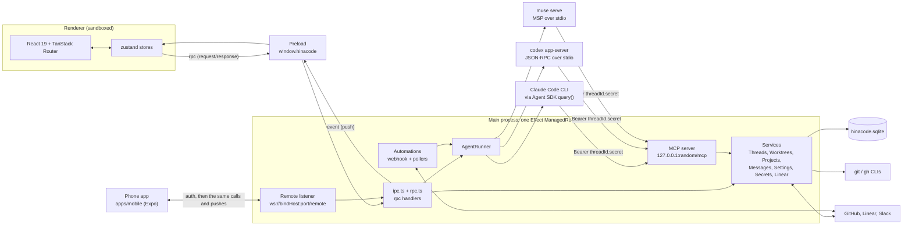

- **The renderer is a view.** It never touches the file system, git, or the agents. Everything goes through `rpc`.
- **Agents call back over MCP.** Both agents get the built-in MCP server, and the bearer credential alone decides which thread a call acts as.
- **Git and GitHub go through the CLIs** (`git`, `gh`), so hinacode uses the user's existing auth and config.
- **Linear goes through one service.** `services/Linear.ts` reads the machine's `linear.apiKey` from `Secrets` and loads the SDK on first use. The MCP tools, the `linear.issue` poller and the `linear.issues` rpc all use it, and the key never leaves the main process. `HINACODE_MOCK_LINEAR=1` answers demo tickets.

## IPC contract

`src/shared/contract.ts` is the single source of truth. Each rpc method has a request and a response schema, and both sides decode them. Pushes are a schema union too.


| Channel | Direction       | Carries                                                                                                                                                                                                                                                                                                                                                                                                    |
| ------- | --------------- | ---------------------------------------------------------------------------------------------------------------------------------------------------------------------------------------------------------------------------------------------------------------------------------------------------------------------------------------------------------------------------------------------------------- |
| `rpc`   | renderer → main | `app.focus`, `projects.*`, `threads.*`, `worktrees.*`, `approvals.respond`, `questions.respond`, `secrets.respond`, `settings.*`, `notifications.*`, `secrets.*`, `ports.*`, `terminal.*`, `automations.*`, `models.list`, `agents.account`, `accounts.*`, `limits.list`, `commands.list`, `files.list`, `git.log`, `git.show`, `fs.list`, `fs.read`, `fs.write`, `fs.watch`, `attachments.stage`, dialogs |
| `event` | main → renderer | `thread.event`, `message.created`, `message.updated` (these carry `seq`), plus `thread.updated`, `worktree.updated`, `worktree.setupLog`, `thread.pullRequests`, `pullRequest.guide`, `thread.subagents`, `automation.run`, `fs.changed`, `terminal.data` (pty output batched per 16 ms), `terminal.exited`                                                                                                |

Only the top-level app frame may send `rpc` (`isTrustedSender` in `security.ts`).

Remote mode (`src/main/remote/`) is a second transport for the same contract. A phone opens a WebSocket on `settings.remote`, sends `{ type: "auth", token }` first, and then `{ type: "call", id, method, payload }` frames go through the same `dispatch` (`rpc.ts`) as the Electron channel with no `DesktopCalls`, while every push is forwarded as `{ type: "event", event }`. The token lives in `Secrets`; `desktopOnlyMethods` in the contract lists what the phone cannot call. Thread create, update and delete push `thread.updated` and `thread.removed`, so the desktop window and a phone stay in step. See `features/2026-10-12-remote-mode.md`. `ready.features` negotiates application heartbeats and mutation call keys. The listener retains keyed mutation results in memory across sockets, while the desktop keeps pending cloud calls through reconnects and retries reads for a fresh snapshot. Calls expire after a total minute offline. The phone keeps its transcript and pending actions during reconnects, then atomically replaces loaded snapshots after `ready`. It reads transcripts with `compact`, which leaves out tool outputs and file diffs it never shows (see `features/2026-10-18-mobile-workbench.md`). A pairing URL carries every reachable host in order; the phone rotates after failed attempts and starts reconnects at its last successful host. Desktop environments probe every host at once, keep the earliest that answers, and wait at most a second for earlier hosts once a later one answered. See `features/2026-10-16-resilient-remote.md`.

`hinacode serve` (`npx hinacode serve`) runs the same layer graph as a headless cloud in plain Node, with no Electron (`src/main/daemon.ts`, built to `out/main/daemon.js` and published to npm). `app.ts` builds the graph for both entries; the daemon passes no keyring, an npm `Updates` (`cloudUpdater.ts`), no window sink, and forces the remote listener on at boot (`serve.ts`), then prints the pairing URLs to stdout. It takes its own `HINACODE_USER_DATA` (default `~/.hinacode-cloud`) and therefore its own database, projects and threads. Main-process code that the daemon loads must not import `electron`; the desktop-only pieces live in `index.ts`, `ipc.ts`, `updater.ts` and `notificationPermission.ts`. See `features/2026-10-14-remote-clouds.md` and [ADR 0016](adr/0016-cloud-daemon-and-dumb-relay.md).

### Environments: routing a window call

A desktop pairs with clouds (`environments.add`) and keeps one live WebSocket to each, speaking the phone's protocol (`services/Environments.ts`). The window has no active environment. `registerIpc` routes every call by `routes[method]` in `src/shared/routes.ts`; the remote listener keeps plain local `dispatch`. See `features/2026-10-15-desktop-environments.md`.

The phone does the same with no local machine: it pairs with each server directly, keeps one `Transport` per server, and `call` in `apps/mobile/src/lib/connection.ts` routes by the same table and owner index. An id no server has claimed waits until every server has listed its threads, and a named call without a server goes to the first connected one. See `features/2026-10-24-mobile-servers.md`.

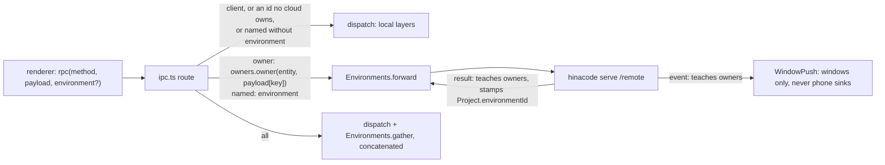

- `src/shared/owners.ts` is an in-memory index of cloud-owned ids (thread, project, worktree, terminal, automation, request, root path, VM stream), taught from every cloud answer and push. An unknown id belongs to this desktop.
- A cloud that is not connected answers `EnvironmentOffline`; for `all` routes it contributes its last answer to the same call. Close code 4001 (`unauthorized`) stops reconnecting. A `ready` with another `REMOTE_PROTOCOL_VERSION` (`incompatible`) fails waiting calls and keeps retrying, like anything else, with jittered backoff from 0.5 s to 60 s. `environments.reconnect` and waking from sleep skip the wait. A ping every 10 s drops a socket silent for 25 s.
- Every data directory has an id (setting row `environment.id`, read by `RemoteAccess`), sent in the `ready` frame. The desktop keys its `environment` rows by it, so pairing the same cloud again updates one row. Tokens are the secrets `environment.<id>.token`.

The visible thread owns its renderer history. Leaving it unloads the transcript even while its agent runs; the main process owns ongoing turns and pending approvals. Reopening reads a fresh sequence-numbered snapshot. Each load has an identity so a response from an earlier visit cannot replace a newer snapshot.

Ready renderer histories publish adjacent text or reasoning deltas in fixed 100 ms groups. A different event flushes the pending group and applies its own change in one store update. Loading histories retain raw sequence-numbered pushes for snapshot reconciliation. Unloading cancels the pending timer and lets the next snapshot restore persisted content. The main process still publishes and folds every event individually; its existing batched persistence is unchanged.

The native window starts hidden. The renderer loads settings, applies appearance, and commits the first React view before calling `app.ready`. Main shows the requesting window after the existing sender and schema checks. System appearance is a renderer media-query subscription shared by the document and diffs; the selected theme remains in SQLite.

## Main-process layers

The main process is one Effect layer graph, built by `src/main/app.ts` before the window can call in. The desktop (`index.ts`) and the cloud daemon (`daemon.ts`) build the same graph.

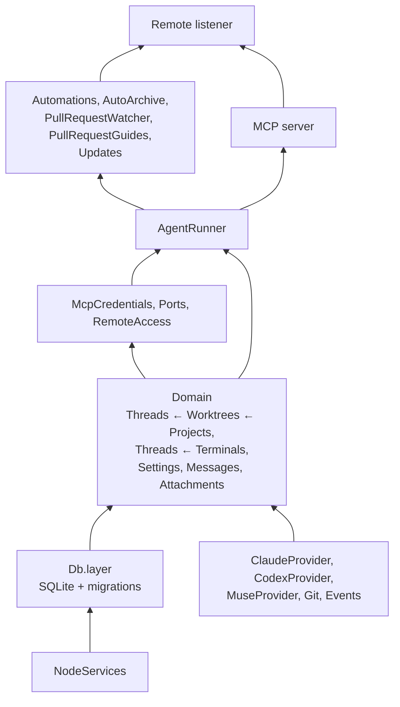

On the desktop, `Updates` only runs in a packaged app. It checks this repository's GitHub releases at launch and every 4 hours, downloads in the background, and pushes `update.changed` when readiness changes. An updater error clears readiness. Squirrel.Mac validates the bundle before installation. See [ADR 0018](adr/0018-releases-next-to-the-source.md). On a cloud it checks npm, installs into the cloud's own global prefix, and restarts in place with `process.execve` (`features/2026-10-20-update-clouds.md`).

The remote listener sits above everything because it dispatches every rpc method, including the automation ones.

The MCP server sits above the runner because its tools start turns (`create_thread`) and ask the user for secrets (`request_secret`). The runner only needs a thread's credential, which `McpCredentials` issues; the server tells it the URL once it listens.

Every service is a `Context.Service` with an id like `"hinacode/Threads"` and an exported `layer`. On quit, `runtime.dispose()` gets up to 5 s, so running turns can persist their messages and status.

## Agent providers

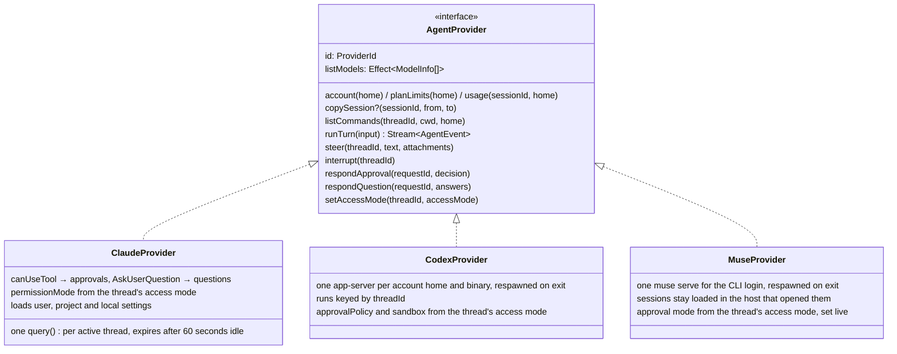

An account is an agent home: `CLAUDE_CONFIG_DIR` or `CODEX_HOME`, holding the login and the transcripts. A thread with `account_id` null runs on the CLI's own login; otherwise its turns get `home = { dir, binary }`, the config directory and CLI the user gave when adding the account. hinacode never signs in or out: the user runs the CLI's login in a terminal, and `AgentLogins` only probes who each home is signed in as. Token usage and plan limits are read from the same home, so `threads.usage` and `limits.list` follow the account. `threads.switchAccount` moves a started thread by copying its session files into the new home with `AgentProvider.copySession`, then resuming the same session id there. It is refused while a turn runs, because the transcript is still being written. Muse Code has no home variable, so it runs on its CLI login only, and `AccountProviderId` leaves it out of added accounts. [`muse-integration-guide.md`](muse-integration-guide.md) explains how the Muse provider speaks MSP.

Each provider translates its native protocol into one `AgentEvent` union (`src/shared/agent.ts`): `session_bound`, `text_delta`, `reasoning_delta`, `tool_call_started`, `tool_call_finished`, `file_changed`, `approval_requested`, `approval_resolved`, `question_requested`, `question_resolved`, `questions_posted`, `turn_completed`, `turn_failed` and `turn_limited`. Everything after the provider is agent-agnostic. A `question_requested` blocks the turn until `questions.respond` answers it; `questions_posted` (Codex's `request_user_input_async`) only adds a `questions` part to the transcript, and the user answers it with their next message. Two more events, `secret_requested` and `secret_resolved`, come from the MCP server's `request_secret` tool rather than the provider; the runner folds them into the running turn the same way.

A Claude turn ends when the CLI reports `session_state_changed: idle`, not at its first result: a background sub-agent can outlive Claude's reply, and when it finishes Claude replies to its report in a response that answers no prompt. The idle event waits for both, so their progress, approvals and Claude's reply land in the same turn. CLIs that do not report state still end the turn at its result. The CLI can also start work after it went idle, for example when a background shell finishes and it resumes the sub-agent that started it. When it reports running with no turn open, the provider opens one and hands it to the runner through `AgentProvider.wakes`, and the runner shows it as a reply with no user message before it. Claude keeps a live CLI for immediate follow-ups, then closes it after 60 idle seconds. Starting a turn cancels expiry before changing model or permission settings. Active turns, approval waits, control requests, and unfinished non-ambient background tasks keep the process alive. The countdown restarts when that work finishes. A small resume record retains the provider session ID and session-scoped grants for the same workspace, account, and instructions. The next turn starts a new CLI with that session ID. Transcript data remains in SQLite and the provider's session files. The memory workload and comparison commands live in [`scripts/perf/README.md`](../scripts/perf/README.md#measure-retained-memory).

Adding a backend touches, besides its `AgentProvider` in `src/main/agents/`:

- `ProviderId`, and `AccountProviderId` if it can have added accounts.
- The `providers` records in `AgentRunner.ts` and `AgentLogins.ts`, the layer in `src/main/app.ts`, and the fake providers of the integration tests that build those layers.
- A migration widening the `provider` CHECK on `thread` and `automation`, as `0011_muse_provider` does.
- The per-agent keys of `Settings.defaultModel` and `defaultAccount`.
- `ProviderIcon.tsx` for the icon and `providerLabel`, the access hints in `ComposerControls.tsx`, `signedOutHint` in `AccountSettings.tsx`, and their messages in both catalogs.
- The capability checklist in [`agent-providers.md`](agent-providers.md), so no harness feature is silently missing.

## A turn, end to end

```mermaid
sequenceDiagram
  autonumber
  actor Dev as Developer
  participant R as Renderer
  participant AR as AgentRunner
  participant WT as Worktrees
  participant G as Git
  participant P as Provider
  participant DB as SQLite

  Dev->>R: send prompt
  R->>AR: rpc threads.send
  AR->>AR: claim busyThreads (reject a second send)
  opt first message with a workspace choice
    AR->>WT: Threads.prepareWorkspace (local: git switch in the root; worktree: branch kk/<placeholder title>)
  end
  AR->>WT: whenPrepared (outside the transcript lock)
  WT-->>R: worktree.setupLog, worktree.updated
  Note over R,AR: Stop cancels the pending send; the setup script continues
  AR->>WT: exclusive(re-read thread, check cancellation, resolve cwd)
  Note over AR,WT: Resolving the cwd and marking the thread running happen in one critical section, so a worktree removal can't delete the directory mid-start
  AR->>G: captureTurnBase(cwd)
  AR->>AR: recheck Stop and guarded delivery
  AR->>DB: recordTurnBase + insert user message + open assistant message
  AR-->>R: push message.created, thread.updated(running)
  AR->>P: runTurn(cwd, model, resumeSessionId, mcpServer)
  loop each AgentEvent
    P-->>AR: event
    AR-->>R: push thread.event (seq)
    AR->>AR: foldTranscript in memory
    AR->>DB: persist dirty messages every 500 ms, or 10x the last persist time if longer
  end
  opt approval
    P-->>AR: approval_requested
    AR-->>R: thread.updated(awaiting_approval)
    Dev->>R: Allow / Allow for session / Deny
    R->>AR: rpc approvals.respond
    AR->>P: respondApproval
  end
  opt sub-agent spawned
    P-->>AR: subagent_updated (full state)
    AR->>AR: keep latest per thread, in memory
    AR-->>R: push thread.subagents (not a transcript push)
    P-->>AR: tool_call_started { parentCallId }
    AR-->>R: thread.event (shown in the sub-agent's view, not the thread's)
  end
  opt request_secret (MCP tool)
    AR-->>R: secret_requested, thread.updated(awaiting_approval)
    Dev->>R: Save / Decline
    R->>AR: rpc secrets.respond
    AR->>AR: Secrets.set, then secret_resolved to the waiting tool
  end
  opt queue while running (Enter)
    Dev->>R: send another message
    R->>AR: rpc threads.queue
    AR->>DB: append to thread.queue, push thread.updated
  end
  opt steer while running (Mod+Enter)
    Dev->>R: send another message
    R->>AR: rpc threads.steer
    AR->>P: steer (same turn)
    AR->>DB: close assistant msg, insert user msg, open new assistant msg
  end
  P-->>AR: turn_completed or turn_failed
  AR->>DB: final persist
  AR-->>R: thread.updated(idle)
  opt turn completed, not stopped, queue not empty
    AR->>DB: take the oldest queued message, keep the busyThreads claim
    AR->>AR: start the next turn with it
  end
```

- Each thread has a `Semaphore` (`exclusive`). Everything that changes a transcript runs under it, so a transcript read never sees a change before the push that announced it.
- `subagent_updated` skips the transcript fold and the `thread.event` push. The runner keeps sub-agents in memory only and serves them through `subagents.list`. When a turn ends, `finish` marks any sub-agent still running as stopped, since nothing will report on it after that.
- Provider errors become `turn_failed`, so `run` never fails and `finish` always runs.
- A turn the agent started (`wakes`) waits until the thread is free, then runs through the same `makeTurn`, so steering, stopping, queueing and `finish` work as for any turn. If the runner cannot adopt it, `Wake.discard` stops the provider turn without reading its stream.
- On boot, `resetInterrupted` and `closeInterrupted` mark anything a killed app left running as over.

A first send waiting for setup keeps its private send claim and cancellation signal, while the thread remains idle with no messages. Transcript reads stay available. Before delivery, the runner re-reads the thread under the worktree lock, rejects an archived or deleted thread, and uses its current provider, account, and model. Acceptance starts at the final cancellation check before message insertion. The same signal reaches the provider-start handoff, so Stop during insertion leaves an accepted, interrupted message without starting the provider. The submitting composer offers Stop through its local sending transition. Reopening shows preparation progress but does not recover that transition's Stop button.

## Renderer sync: snapshot plus pushes

The database lags a running turn by up to 500 ms, or ten times the last persist time once a write takes longer than 50 ms, so `threads.transcript` overlays the in-memory turn on top of persisted rows and returns the current `seq`.

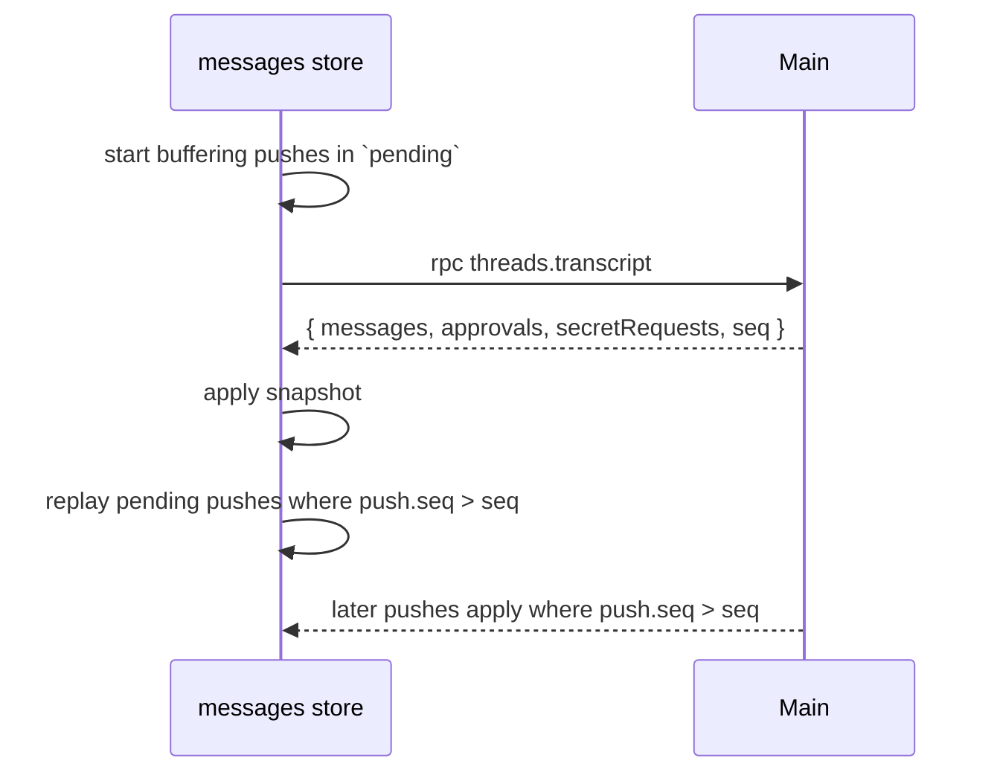

Electron IPC can deliver the reply before pushes sent earlier, so a push the snapshot already holds can still arrive after it. The store drops it by `seq`, and drops a reply whose load was superseded by its load token. `specs/TranscriptSync.tla` checks both.

## Thread side panel

The right edge of the thread route is an activity bar: one icon per view, and the selected view to its left. `sidePanel/views.ts` holds the registry, one entry per view with its icon, title, command and component. The bar, the content area and the `view.*` commands all render from that array, so adding a view is one entry and no branch anywhere else. `useUi` remembers the view per thread and the last one picked; picking the shown view again hides the panel.

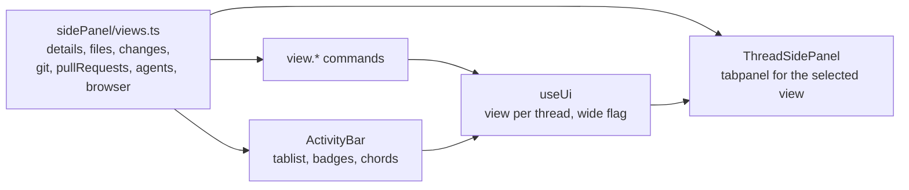

The Files view reads the disk only through `Files` in main. `fs.list` lists one folder level with ignore and git status, `fs.read` returns up to 1 MB of one file, `fs.write` replaces the text of an existing file unless it changed on disk since the edit began, and `fs.watch` sets the folders that push `fs.changed`. All four accept only a known project root or live worktree as `root` and refuse any `path` whose realpath leaves it.

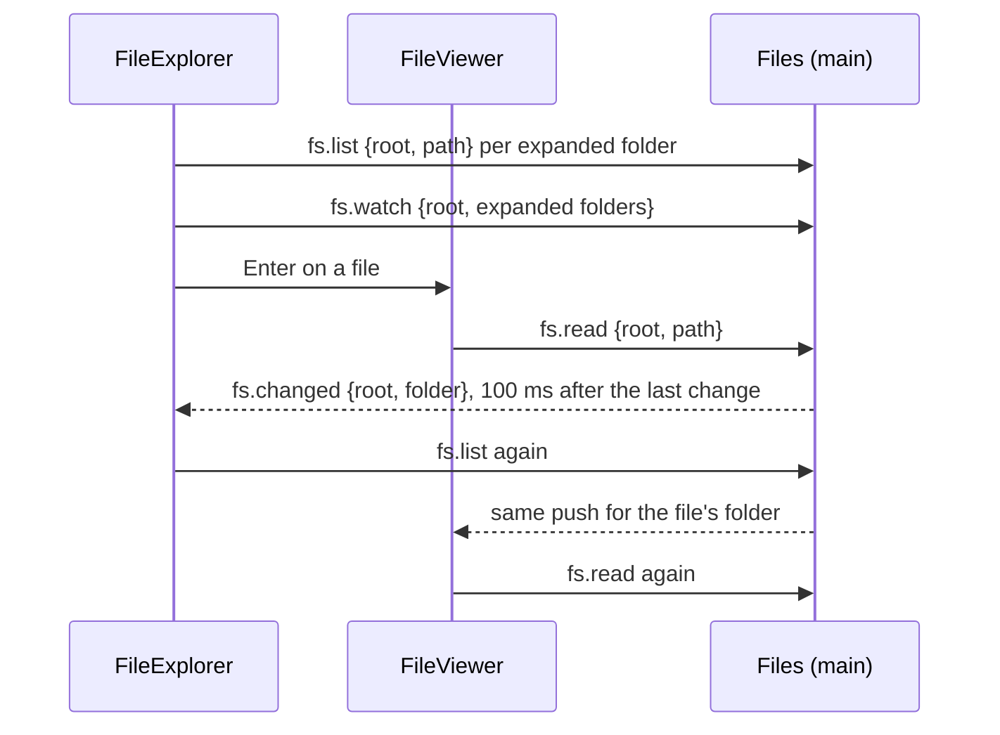

The Browser view is a `<webview>` in the `persist:browser` session (ADR 0014). Picking runs a self-contained script in the page and turns the result into an image attachment that carries the element.

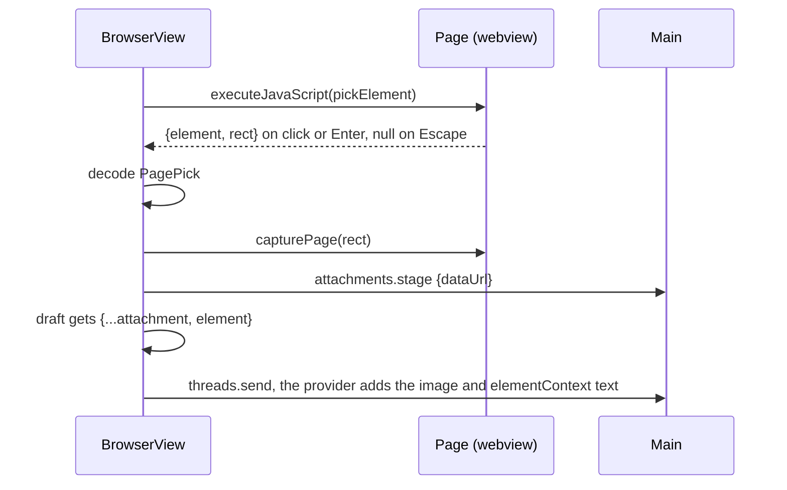

## Keybindings

Shortcuts are renderer-only and run on [TanStack Hotkeys](https://tanstack.com/hotkeys/latest). `keybindings/commands.ts` is the registry: each `Command` has an id, a default chord string such as `mod+shift+n`, a title and `run(ctx)`. Settings stores only the user's overrides, keyed by command id.

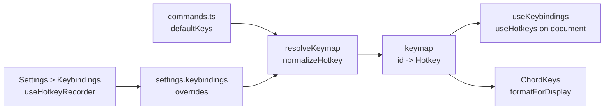

- **One normalization point.** `resolveKeymap` accepts any chord TanStack can parse: lowercase defaults, overrides saved before the switch, and recordings such as `Mod+Shift+[KeyK]`. The recorder stores physical keys, so a binding stays on the same key across layouts. Defaults are logical keys with a physical fallback.
- **Conflicts** compare chords by their display label (`sameChord`), so a recorded physical key and a default on the same key count as one shortcut. `useKeybindings` binds each chord once, first command in registry order winning.
- **Fields.** Plain keys and Shift or Alt combos typed into a field never run a command. Control and Meta chords do.
- **`when` clauses.** A command may set `when`, a VS Code style condition on where the keydown happened, such as `"!terminalFocus"`. A chord whose clause fails does nothing and keeps its default action. The palette ignores `when`.
- **Terminal.** wterm sends the Control chords it can encode to the shell and stops them, so they never bubble to document. `useKeybindings` therefore also listens in the capture phase: a Control or Meta chord typed into a terminal whose command's `when` holds runs there and never reaches the shell, like VS Code's `commandsToSkipShell`. Defaults the shell already uses outside macOS (Ctrl+L, Ctrl+B, Ctrl+N, Ctrl+F, Ctrl+Shift+C, Ctrl+Shift+A) set `!terminalFocus`. Keys without Control or Meta always go to the shell.

## Data model

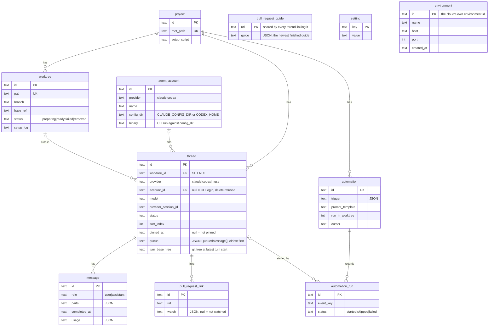

- `setting` holds both settings and secrets. Secrets live under `secret.<name>` and are sealed by the `Keyring` the entry point provides: Electron `safeStorage` on the desktop (the real login Keychain in the packaged app, Chromium's mock keychain in unpackaged runs), and none in `hinacode serve`, which stores them as plaintext. A secret that won't decrypt under the current key reads as unset.
- `setting` rows are split between `Settings` (the environment: models, archive, worktree root, ...) and `ClientSettings` (this desktop: locale, keybindings, appearance, notifications). The keys never overlap; a cloud only reads `Settings`.
- `environment` (migration `0015_environments`) lists the clouds this desktop paired with. It is unrelated to the other tables: a cloud's projects and threads stay in the cloud's database.
- `Threads.captureTurnBase` returns the working tree's snapshot without changing the thread row. An unreadable or non-git directory returns null. The runner calls `recordTurnBase` only after its final delivery checks, so rejected input preserves the last accepted turn's baseline and diff. An accepted input with no snapshot records null.
- A removed worktree keeps its row, and `thread.worktree_id` keeps pointing at it so history shows where the thread ran. Always resolve the working directory through `makeActiveWorkspace` (`services/workspace.ts`), which falls back to the project root.

## Lifecycles

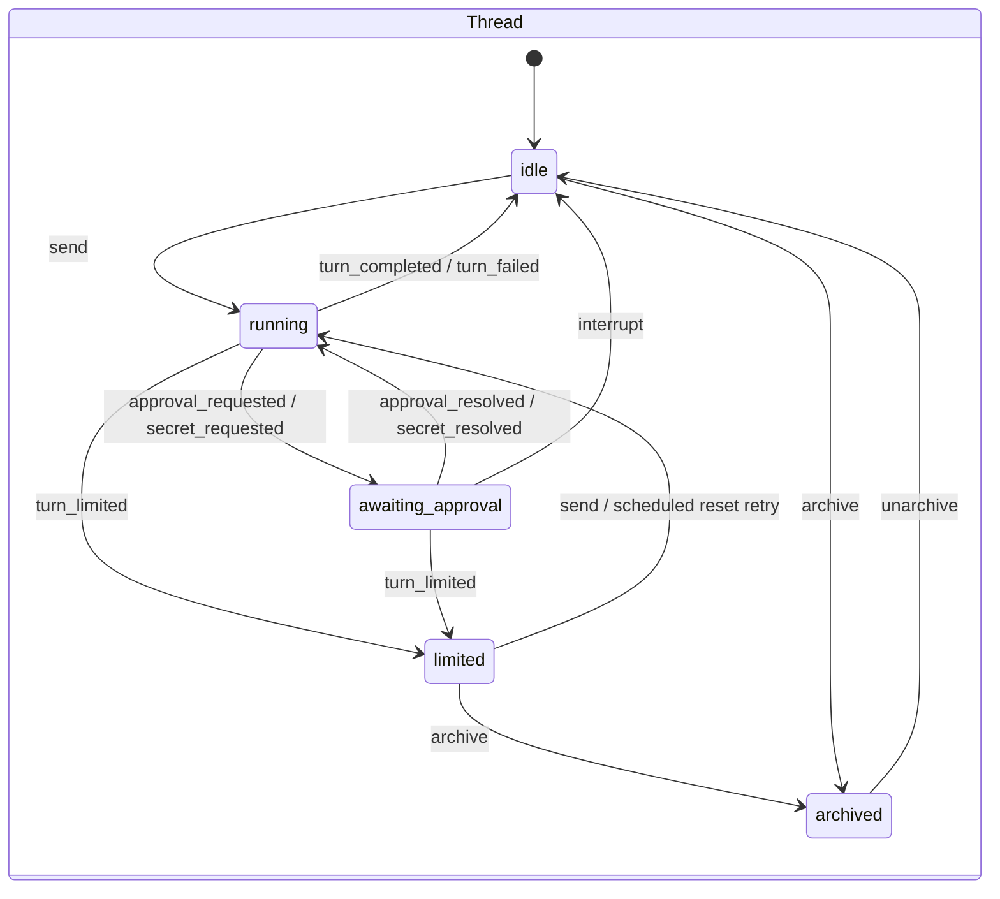

Limited threads persist a typed `usageLimit` in the thread row. A usage limit can carry a provider-confirmed reset time and an opt-in automatic resume flag. Organization spend limits carry no reset schedule. The runner checks due requests in its scoped fiber, consumes each request once, then resends the last user prompt and attachments through the normal send path. Manual sends and archiving clear the limit. Restart preserves limited threads and scheduled requests.

A thread with a worktree, as `specs/WorktreeLifecycle.tla` models it. `pnpm chart:thread` redraws this chart from every state TLC reaches, and `WorktreeLifecycle.Liveness.cfg` checks that archiving works from each of them, whatever the setup script does. `running` stands for `awaiting_approval` too, and a row still `preparing` at boot becomes `failed`.

<!-- thread-chart:start -->

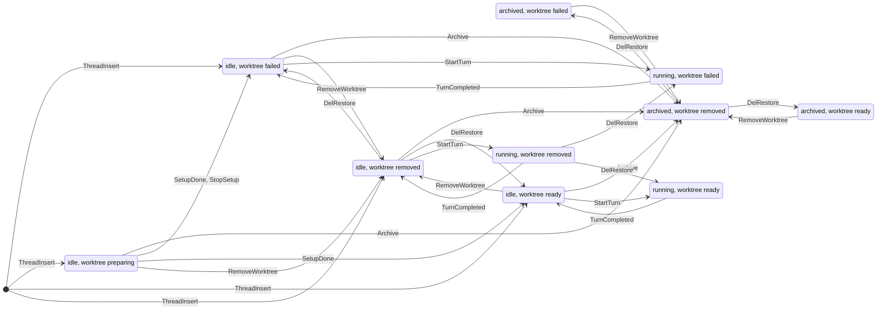

<!-- thread-chart:end -->

- **Setup scripts** run with `$HINACODE_ROOT_PATH`, `$HINACODE_WORKTREE_PATH` and `$HINACODE_BRANCH`. A row still `preparing` at boot becomes `failed`, never re-run, because re-running an arbitrary script unasked isn't safe. A script can hang, so the setup log has a Stop button (`worktrees.stopSetup`), and removing the worktree stops it too. Stopping kills the script's process group, with SIGKILL after 3 seconds, and the worktree ends `failed`, so a send waiting on it goes ahead.
- **Terminals** live in main memory until closed, with their thread, or with the app, and outlive a renderer reload. Each keeps its last 256 KiB of UTF-8 output, and every `terminal.data` carries `offset`, where its text starts in the session's output, in UTF-16 characters. A screen calls `terminal.attach` with the offset it has reached when its session opens, when the drawer first lists the sessions, when a cloud reconnects, and when a push skips ahead. The answer appends, or clears the screen when the scrollback no longer reaches that offset, and pushes that overlap it are trimmed (`lib/terminalStream.ts`). An exited session can be attached until it is closed.
- **Archiving** a thread hides it in the sidebar's Archived tab, and unarchiving brings it back as `idle`. Archiving refuses a `running` or `awaiting_approval` thread with `ThreadBusyError`. It checks the status, removes the worktree, ends the thread's terminals and writes `archived` inside `Worktrees.exclusive`, where a turn also marks its thread running, so a turn cannot start halfway through an archive. With `settings.archive.removeWorktree` on, archiving also removes its worktree. The branch is deleted only when it is merged into the worktree's base ref. The row turns `removed` at once, and the files and branch are deleted on a detached fiber, so archiving a large tree returns immediately. Creating the same branch again waits for that deletion. An unarchived thread whose worktree is gone works in the project root.
- **AutoArchive** sweeps every 3 minutes while `settings.archive.whenMerged` is on. It asks `gh` for each linked pull request of threads that are neither archived nor mid-turn, archives the threads whose links are all merged, and pushes `thread.updated`.
- **PullRequestWatcher** sweeps every minute over links whose `watch` JSON is set. It diffs a fresh `gh` detail read against the snapshot the thread was last told about (`services/pullRequestWatch.ts`), and wakes the thread through `AgentRunner.steerWhen` when checks fail or pass, the review changes, the branch conflicts, or the pull request merges or closes. Each watch start has a fresh UUID generation. The runner rechecks thread eligibility and generation inside the thread semaphore for active steering, or inside the worktree lock for an idle turn. Queued news cannot revive an archived thread or bypass a new approval or usage limit. Stopped watches cannot deliver unaccepted news, while accepted delivery can finish after a stop. Poll writes compare the generation in their SQL update, so they cannot overwrite a replacement watch. The snapshot only moves when its news was delivered or a poll found no news. A watch ends on merge or close, after 25 wakes, or after 15 unreadable polls in a row. See [the feature doc](features/2026-10-14-pull-request-watch.md).
- **Removal is refused** (`WorktreeBusyError`) while a thread in the checkout is mid-turn, or while another open thread uses it. A branch has at most one live worktree (`WorktreeTakenError`). See [ADR 0006](adr/0006-worktree-ownership.md).
- **PullRequestGuides** keeps one rule. When main learns a pull request's head, a guide for that head exists or is being written. It learns heads from a sweep every 3 minutes over the open pull requests linked to unarchived threads, and from every `github.pullRequestDetail` call. A guide is pulls.review's prompt (`@pulls.review/core`) run through the Claude Agent SDK with structured output, at the model and effort in `settings.pullRequestGuide`. One runs at a time, and a new head interrupts the one for the head it replaced. The newest finished guide is stored per url. Running and failed jobs live in memory, so a failed head is tried again only on Retry, a new head or a restart. See [the feature doc](features/2026-10-23-pull-request-guide.md).
- A user's thread starts empty, titled `thread-xxxxx`. Its agent and workspace stay editable in the composer until its first message (`ThreadStartedError` after). That message can move it into a new worktree, and `ThreadNaming` then titles the thread and renames the branch in the background (only the title for a thread already linked to a pull request when naming starts, such as a pull request checkout, whose branch must keep its name), using the Claude model in `settings.textGenerationModel`. A title the user edited in the meantime is kept. Automation threads skip naming.

## Built-in MCP server

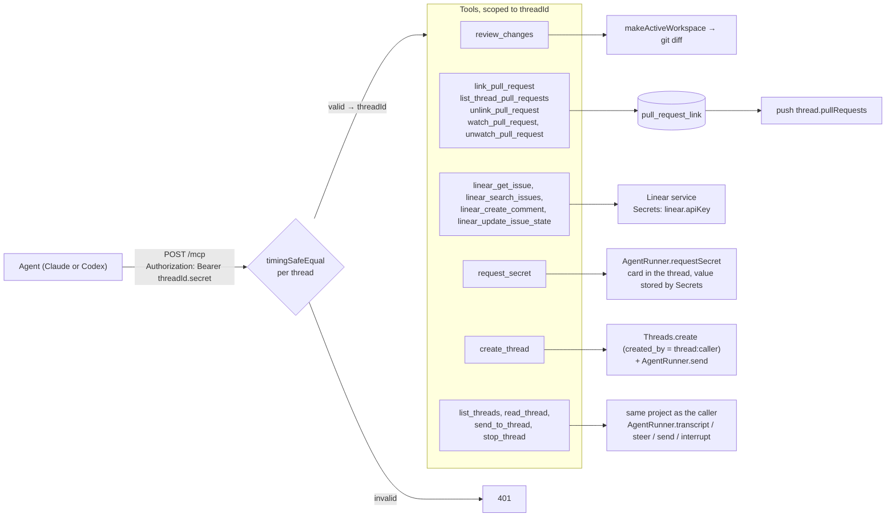

`request_secret` blocks until the user answers the card or the turn ends; the value goes renderer → main → `Secrets` and never into an event, a message or the tool result. `create_thread` makes an ordinary thread of the same project: `created_by` records where it came from, nothing else ties it to its creator. The thread controls reach any thread of the caller's project, not only the ones it created; `send_to_thread` and `stop_thread` refuse the caller itself. Codex gets `tool_timeout_sec = 600` for this server so a user has time to answer.

Each tool's parameters are an Effect Schema. The same schema produces the JSON Schema shown to the agent and decodes its input.

How each agent gets its credential ([ADR 0007](adr/0007-per-thread-mcp-credentials.md)):

- **Claude** connects through an in-process forwarder (`agents/claude/mcp.ts`), so the CLI never sees the credential.
- **Codex** receives it as a header in its thread config over stdin. Codex asks before each MCP call with `mcpServer/elicitation/request`, which hinacode shows as an approval.
- **Muse Code** receives it as a header in the session's `config.mcpServers` over stdin, which needs the `sessionMcp` capability. Muse treats the server as required and fails the turn if it cannot reach it.

## Automations

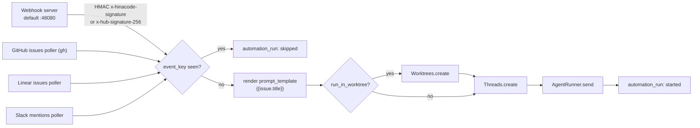

- Pollers keep a `cursor` per automation. The first poll starts from now and doesn't replay history.
- A repeated poll error is recorded once, not once per poll.

## Security boundaries

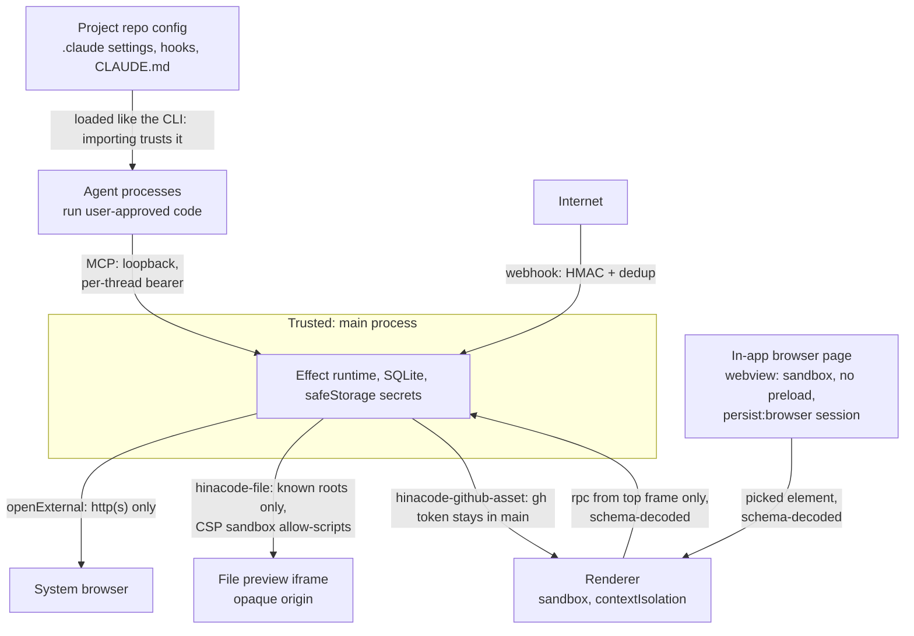

Decisions behind these boundaries: [0007](adr/0007-per-thread-mcp-credentials.md) for MCP credentials, [0008](adr/0008-import-trusts-the-project.md) for why importing a project trusts it, [0009](adr/0009-scoped-session-approvals.md) for session approvals, and [0014](adr/0014-webview-for-the-in-app-browser.md) for the in-app browser. The threat model is a single user on their own machine. We defend against untrusted web content and unauthenticated network callers. A project the user imports is trusted, the same as opening it in the CLI. An attacker who already has the user's shell is out of scope.

## Where things live

| Concern                                   | Path                                                       |
| ----------------------------------------- | ---------------------------------------------------------- |
| Layer graph                               | `src/main/app.ts`                                          |
| Window, custom protocols                  | `src/main/index.ts`                                        |
| Cloud daemon (`hinacode serve`)           | `src/main/daemon.ts`                                       |
| rpc handlers                              | `src/main/rpc.ts`                                          |
| Electron rpc channel, window calls        | `src/main/ipc.ts`                                          |
| Navigation, external links, sender checks | `src/main/security.ts`                                     |
| Turn orchestration                        | `src/main/services/AgentRunner.ts`                         |
| Transcript folding (shared with renderer) | `src/shared/foldEvent.ts`                                  |
| Worktree lifecycle, diff, archive         | `src/main/services/Worktrees.ts`, `Git.ts`, `workspace.ts` |
| Commit graph (log, show, lane layout)     | `src/main/services/Git.ts`, `src/renderer/lib/gitGraph.ts` |
| Providers                                 | `src/main/agents/claude/`, `src/main/agents/codex/`        |
| MCP server and tools                      | `src/main/mcp/`                                            |
| Automations                               | `src/main/services/automations/`                           |
| Contracts                                 | `src/shared/contract.ts`, `domain.ts`, `agent.ts`          |
| Renderer state                            | `src/renderer/stores/`                                     |
| Side panel views and activity bar         | `src/renderer/components/sidePanel/`                       |
| File listing, reading, watching           | `src/main/services/Files.ts`                               |
| Development resource monitor              | `src/main/resourceMonitor.ts`, `tools/resource-monitor/`   |
