# Architecture

kkcode is one Electron app with three processes: the renderer, the preload, and the main process. The main process runs the agents and talks to them over a child process (Codex) or the Agent SDK (Claude). Everything durable is in one SQLite file. Why it is shaped this way: [`adr/`](adr/). The product design: [`features/2026-10-11-kkcode-foundation.md`](features/2026-10-11-kkcode-foundation.md).

## System overview

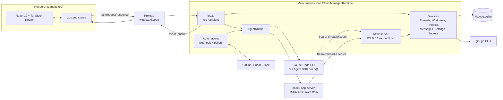

- **The renderer is a view.** It never touches the file system, git, or the agents. Everything goes through `rpc`.
- **Agents call back over MCP.** Both agents get the built-in MCP server, and the bearer credential alone decides which thread a call acts as.
- **Git and GitHub go through the CLIs** (`git`, `gh`), so kkcode uses the user's existing auth and config.

## IPC contract

`src/shared/contract.ts` is the single source of truth. Each rpc method has a request and a response schema, and both sides decode them. Pushes are a schema union too.

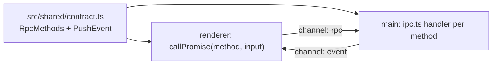

| Channel | Direction       | Carries                                                                                                                                                                                                                                                                                           |
| ------- | --------------- | ------------------------------------------------------------------------------------------------------------------------------------------------------------------------------------------------------------------------------------------------------------------------------------------------- |
| `rpc`   | renderer → main | `projects.*`, `threads.*`, `worktrees.*`, `approvals.respond`, `questions.respond`, `secrets.respond`, `settings.*`, `secrets.*`, `ports.*`, `automations.*`, `models.list`, `commands.list`, `files.list`, `git.log`, `git.show`, `fs.list`, `fs.read`, `fs.watch`, `attachments.stage`, dialogs |
| `event` | main → renderer | `thread.event`, `message.created`, `message.updated` (these carry `seq`), plus `thread.updated`, `worktree.updated`, `worktree.setupLog`, `thread.pullRequests`, `thread.subagents`, `automation.run`, `fs.changed`                                                                               |

Only the top-level app frame may send `rpc` (`isTrustedSender` in `security.ts`).

Ready renderer histories publish adjacent text or reasoning deltas in fixed 100 ms groups. A different event flushes the pending group and applies its own change in one store update. Loading histories retain raw sequence-numbered pushes for snapshot reconciliation. Unloading cancels the pending timer and lets the next snapshot restore persisted content. The main process still publishes and folds every event individually; its existing batched persistence is unchanged.

The native window starts hidden. The renderer loads settings, applies appearance, and commits the first React view before calling `app.ready`. Main shows the requesting window after the existing sender and schema checks. System appearance is a renderer media-query subscription shared by the document, diffs, and Mermaid; the selected theme remains in SQLite.

## Main-process layers

The main process is one Effect layer graph, built in `src/main/index.ts` before the window can call in.

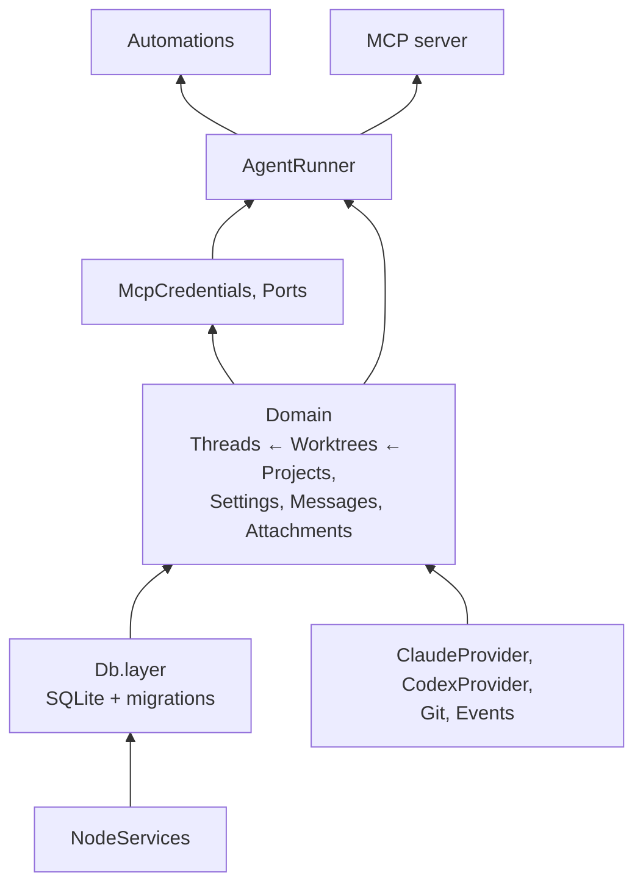

The MCP server sits above the runner because its tools start turns (`create_thread`) and ask the user for secrets (`request_secret`). The runner only needs a thread's credential, which `McpCredentials` issues; the server tells it the URL once it listens.

Every service is a `Context.Service` with an id like `"kkcode/Threads"` and an exported `layer`. On quit, `runtime.dispose()` gets up to 5 s, so running turns can persist their messages and status.

## Agent providers

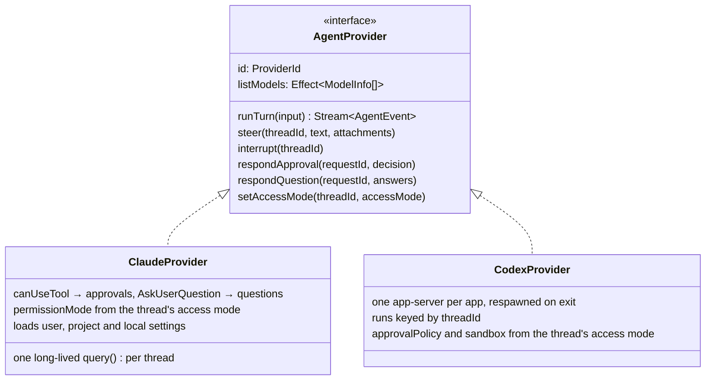

Each provider translates its native protocol into one `AgentEvent` union (`src/shared/agent.ts`): `session_bound`, `text_delta`, `reasoning_delta`, `tool_call_started`, `tool_call_finished`, `file_changed`, `approval_requested`, `approval_resolved`, `question_requested`, `question_resolved`, `questions_posted`, `turn_completed`, `turn_failed` and `turn_limited`. Everything after the provider is agent-agnostic. A `question_requested` blocks the turn until `questions.respond` answers it; `questions_posted` (Codex's `request_user_input_async`) only adds a `questions` part to the transcript, and the user answers it with their next message. Two more events, `secret_requested` and `secret_resolved`, come from the MCP server's `request_secret` tool rather than the provider; the runner folds them into the running turn the same way.

Adding a backend means one `AgentProvider` implementation in `src/main/agents/`, one entry in the `providers` record in `AgentRunner.ts`, and one literal in `ProviderId`.

## A turn, end to end

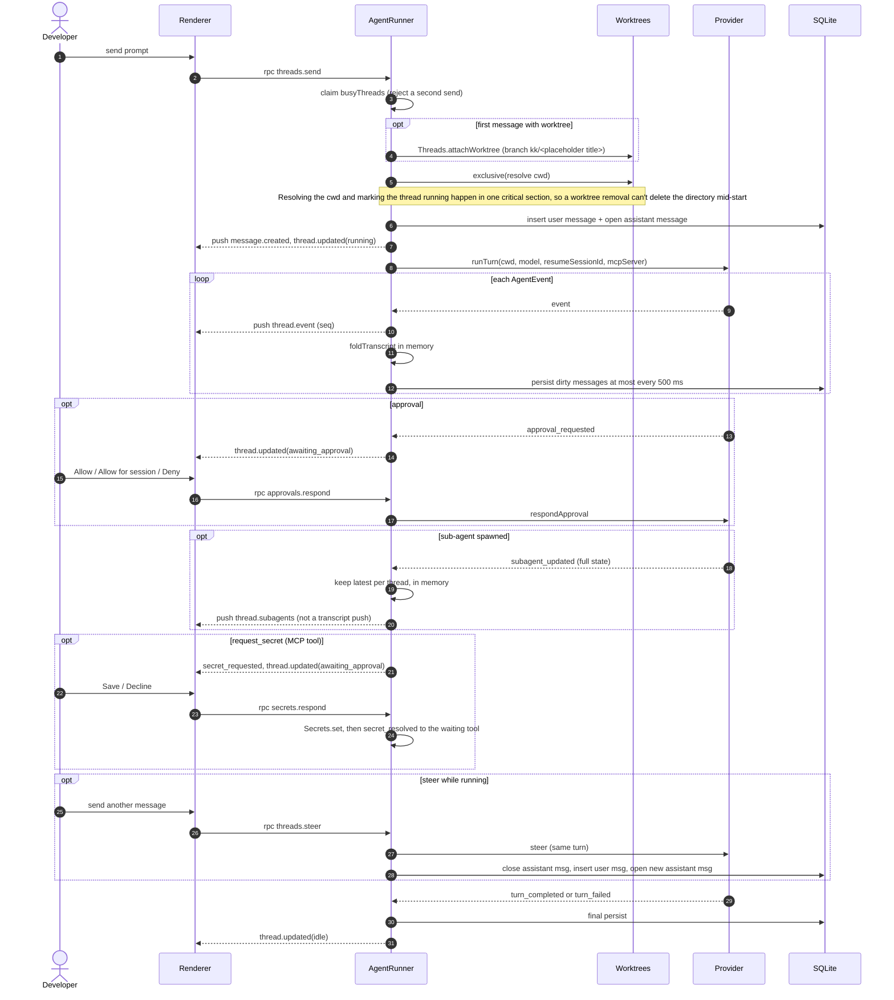

- Each thread has a `Semaphore` (`exclusive`). Everything that changes a transcript runs under it, so a transcript read never sees a change before the push that announced it.
- `subagent_updated` skips the transcript fold and the `thread.event` push. The runner keeps sub-agents in memory only and serves them through `subagents.list`.
- Provider errors become `turn_failed`, so `run` never fails and `finish` always runs.
- On boot, `resetInterrupted` and `closeInterrupted` mark anything a killed app left running as over.

## Renderer sync: snapshot plus pushes

The database lags a running turn by up to 500 ms, so `threads.transcript` overlays the in-memory turn on top of persisted rows and returns the current `seq`.

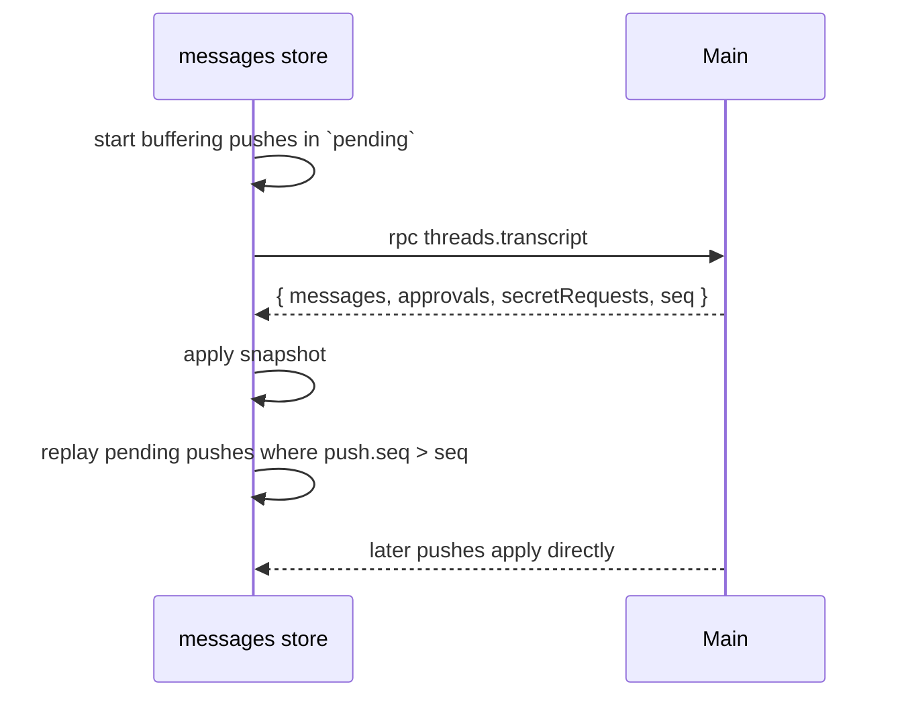

## Thread side panel

The right edge of the thread route is an activity bar: one icon per view, and the selected view to its left. `sidePanel/views.ts` holds the registry, one entry per view with its icon, title, command and component. The bar, the content area and the `view.*` commands all render from that array, so adding a view is one entry and no branch anywhere else. `useUi` remembers the view per thread and the last one picked; picking the shown view again hides the panel.

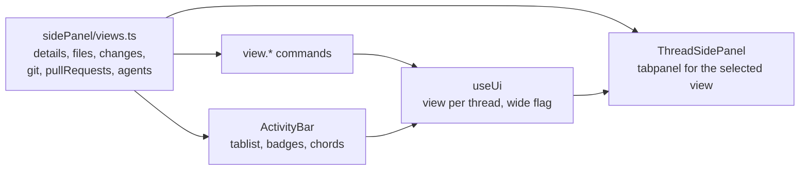

The Files view reads the disk only through `Files` in main. `fs.list` lists one folder level with ignore and git status, `fs.read` returns up to 1 MB of one file, and `fs.watch` sets the folders that push `fs.changed`. All three accept only a known project root or live worktree as `root` and refuse any `path` whose realpath leaves it.

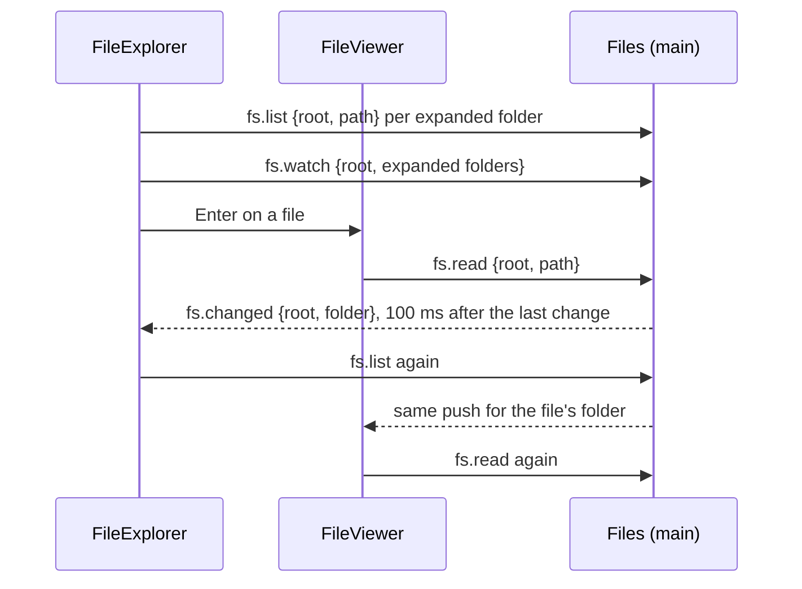

## Keybindings

Shortcuts are renderer-only and run on [TanStack Hotkeys](https://tanstack.com/hotkeys/latest). `keybindings/commands.ts` is the registry: each `Command` has an id, a default chord string such as `mod+shift+n`, a title and `run(ctx)`. Settings stores only the user's overrides, keyed by command id.

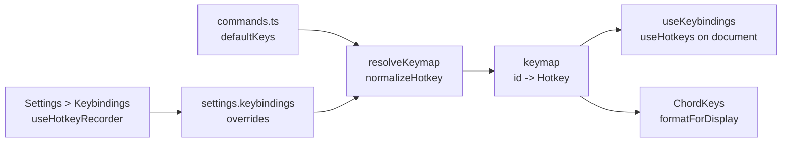

- **One normalization point.** `resolveKeymap` accepts any chord TanStack can parse: lowercase defaults, overrides saved before the switch, and recordings such as `Mod+Shift+[KeyK]`. The recorder stores physical keys, so a binding stays on the same key across layouts. Defaults are logical keys with a physical fallback.
- **Conflicts** compare chords by their display label (`sameChord`), so a recorded physical key and a default on the same key count as one shortcut. `useKeybindings` binds each chord once, first command in registry order winning.
- **Fields.** Plain keys and Shift or Alt combos typed into a field never run a command. Control and Meta chords do.
- **Terminal scope.** `useTerminalScope(ref)` marks an element that owns every key without Control or Meta, including Escape. App commands skip those keys there and leave the event untouched. Control and Meta chords still run app commands when the element lets the keydown bubble, so the terminal engine lets every keydown for which `isAppChord(event)` is true reach the app.

## Data model

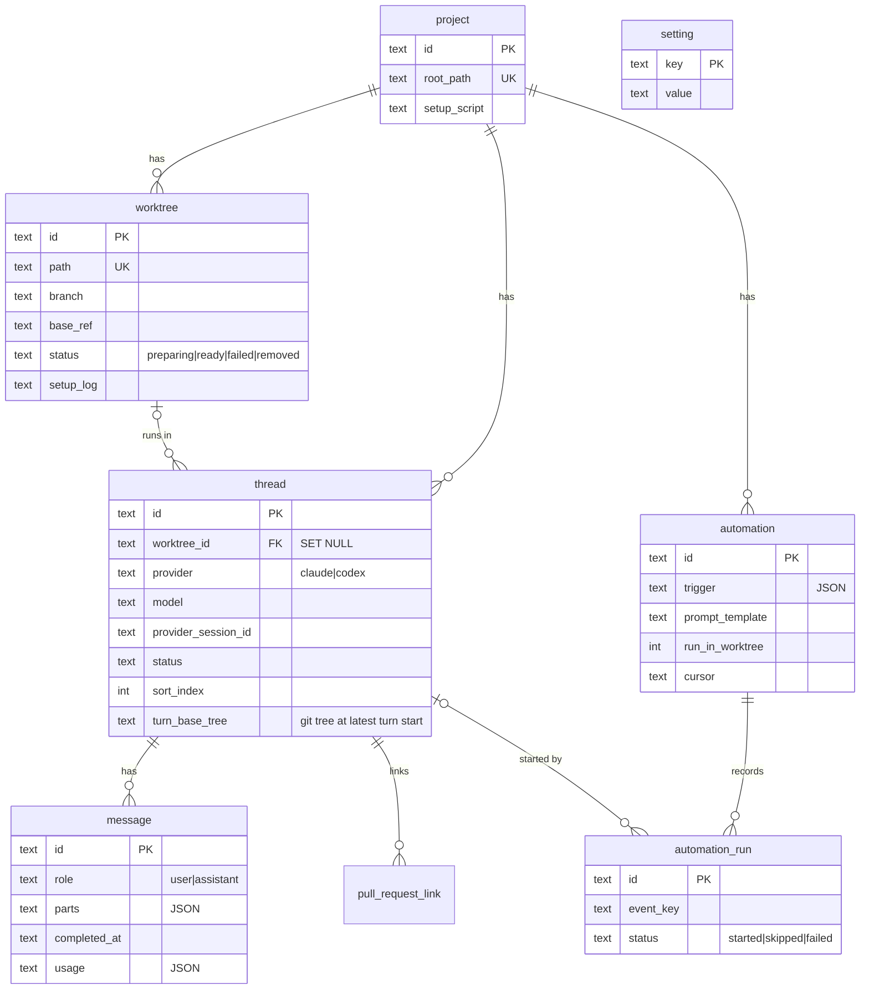

- `setting` holds both settings and secrets. Secrets live under `secret.<name>` and are encrypted with Electron `safeStorage`.
- A removed worktree keeps its row, and `thread.worktree_id` keeps pointing at it so history shows where the thread ran. Always resolve the working directory through `makeActiveWorkspace` (`services/workspace.ts`), which falls back to the project root.

## Lifecycles

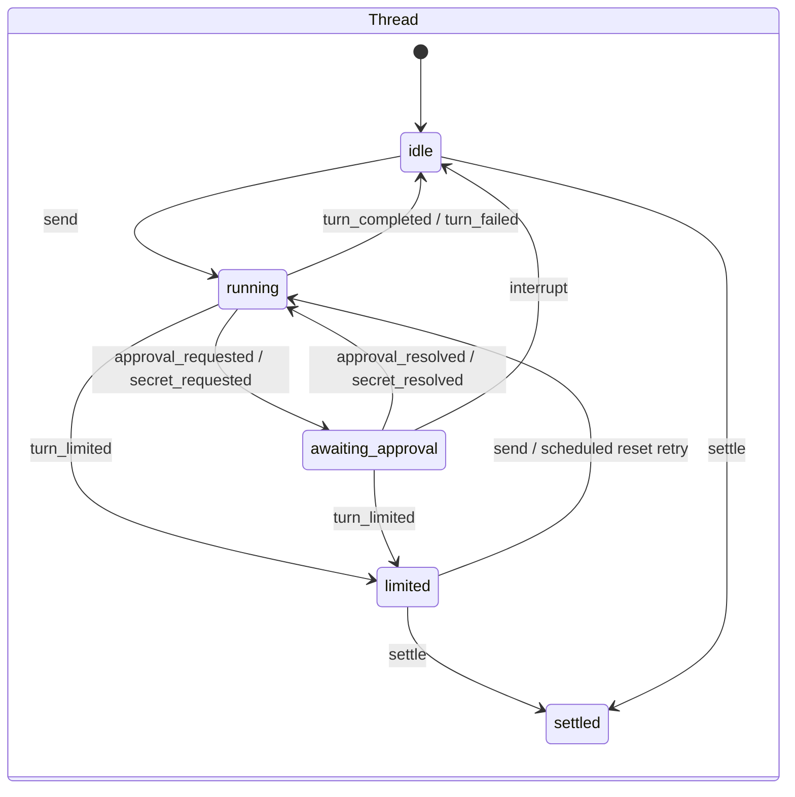

Limited threads persist a typed `usageLimit` in the thread row. A usage limit can carry a provider-confirmed reset time and an opt-in automatic resume flag. Organization spend limits carry no reset schedule. The runner checks due requests in its scoped fiber, consumes each request once, then resends the last user prompt and attachments through the normal send path. Manual sends and settling clear the limit. Restart preserves limited threads and scheduled requests.

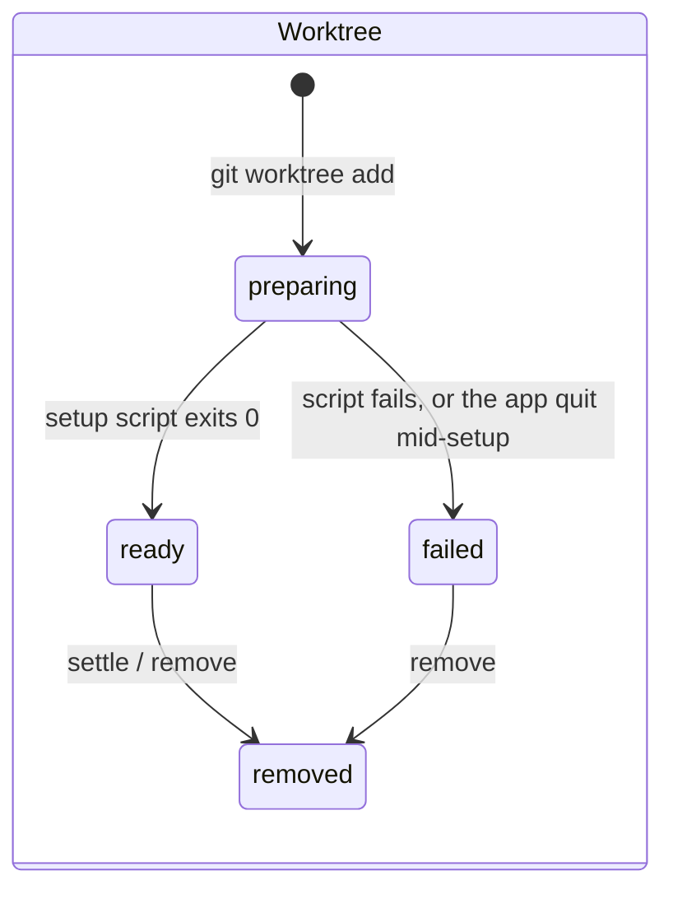

- **Setup scripts** run with `$KKCODE_ROOT_PATH`, `$KKCODE_WORKTREE_PATH` and `$KKCODE_BRANCH`. A row still `preparing` at boot becomes `failed`, never re-run, because re-running an arbitrary script unasked isn't safe.
- **Settling** a thread removes its worktree. The branch is deleted only when it is merged into the worktree's base ref. The row turns `removed` at once, and the files and branch are deleted on a detached fiber, so settling a large tree returns immediately. Creating the same branch again waits for that deletion.
- **Removal is refused** (`WorktreeBusyError`) while setup runs, while a thread in the checkout is mid-turn, or while another open thread uses it. A branch has at most one live worktree (`WorktreeTakenError`). See [ADR 0006](adr/0006-worktree-ownership.md).
- A user's thread starts empty, titled `thread-xxxxx`. Its agent and workspace stay editable in the composer until its first message (`ThreadStartedError` after). That message can move it into a new worktree, and `ThreadNaming` then titles the thread and renames the branch in the background, using the Claude model in `settings.textGenerationModel`. A title the user edited in the meantime is kept. Automation threads skip naming.
- `archived` exists in the schema but nothing sets it yet.

## Built-in MCP server

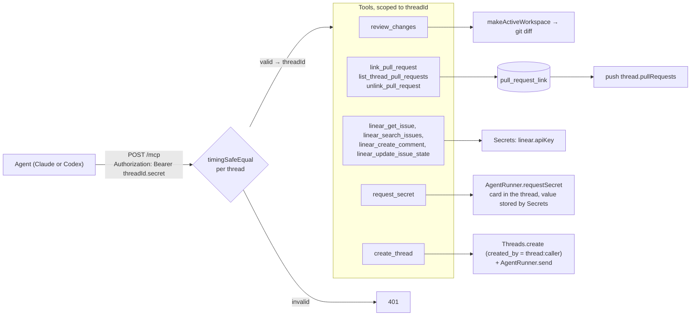

`request_secret` blocks until the user answers the card or the turn ends; the value goes renderer → main → `Secrets` and never into an event, a message or the tool result. `create_thread` makes an ordinary thread of the same project: `created_by` records where it came from, nothing else ties it to its creator. Codex gets `tool_timeout_sec = 600` for this server so a user has time to answer.

Each tool's parameters are an Effect Schema. The same schema produces the JSON Schema shown to the agent and decodes its input.

How each agent gets its credential ([ADR 0007](adr/0007-per-thread-mcp-credentials.md)):

- **Claude** connects through an in-process forwarder (`agents/claude/mcp.ts`), so the CLI never sees the credential.
- **Codex** receives it as a header in its thread config over stdin. Codex asks before each MCP call with `mcpServer/elicitation/request`, which kkcode shows as an approval.

## Automations

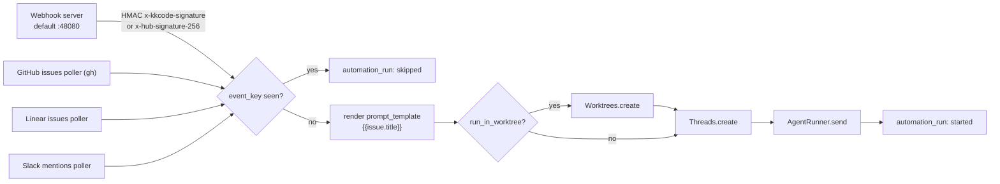

- Pollers keep a `cursor` per automation. The first poll starts from now and doesn't replay history.
- A repeated poll error is recorded once, not once per poll.

## Security boundaries

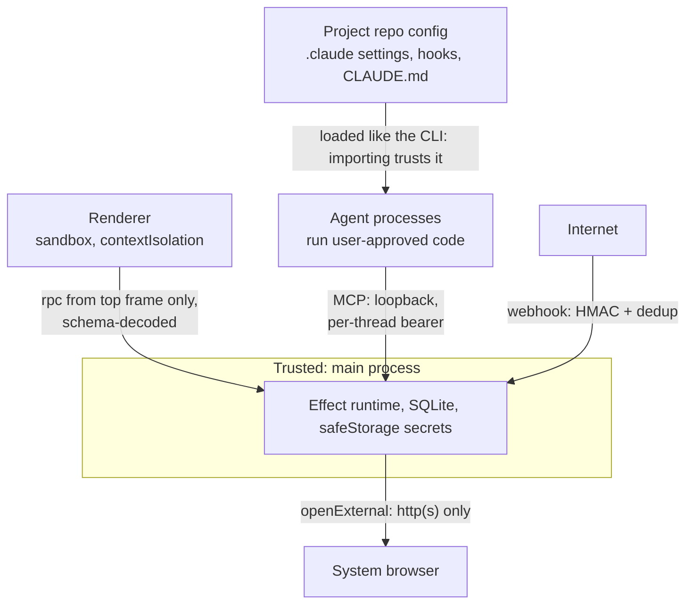

Decisions behind these boundaries: [0007](adr/0007-per-thread-mcp-credentials.md) for MCP credentials, [0008](adr/0008-import-trusts-the-project.md) for why importing a project trusts it, and [0009](adr/0009-scoped-session-approvals.md) for session approvals. The threat model is a single user on their own machine. We defend against untrusted web content and unauthenticated network callers. A project the user imports is trusted, the same as opening it in the CLI. An attacker who already has the user's shell is out of scope.

## Where things live

| Concern                                   | Path                                                       |
| ----------------------------------------- | ---------------------------------------------------------- |
| Layer graph, window, attachment protocol  | `src/main/index.ts`                                        |
| rpc handlers, event push                  | `src/main/ipc.ts`                                          |
| Navigation, external links, sender checks | `src/main/security.ts`                                     |
| Turn orchestration                        | `src/main/services/AgentRunner.ts`                         |
| Transcript folding (shared with renderer) | `src/shared/foldEvent.ts`                                  |
| Worktree lifecycle, diff, settle          | `src/main/services/Worktrees.ts`, `Git.ts`, `workspace.ts` |
| Commit graph (log, show, lane layout)     | `src/main/services/Git.ts`, `src/renderer/lib/gitGraph.ts` |
| Providers                                 | `src/main/agents/claude/`, `src/main/agents/codex/`        |
| MCP server and tools                      | `src/main/mcp/`                                            |
| Automations                               | `src/main/services/automations/`                           |
| Contracts                                 | `src/shared/contract.ts`, `domain.ts`, `agent.ts`          |
| Renderer state                            | `src/renderer/stores/`                                     |
| Side panel views and activity bar         | `src/renderer/components/sidePanel/`                       |
| File listing, reading, watching           | `src/main/services/Files.ts`                               |
