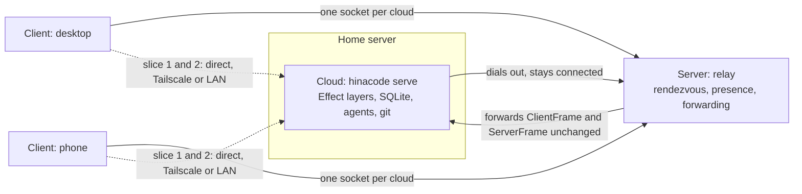

# Remote clouds: daemon, relay and multi-cloud clients

Status: Building (slice 1)
Date: 2026-10-14

## Problem

Remote mode (`features/2026-10-12-remote-mode.md`) lets a phone steer threads, but the agents still run inside the desktop app on the desk machine. Close the laptop and every agent stops. A developer with an always-on machine at home (a Mac mini, a Linux box, a small VM) wants the agents to run there: threads, worktrees, terminals, PR watching and automations keep going while no desktop window exists anywhere, and the desktop and phone become interchangeable windows onto them. When that machine sits behind NAT or on another network, the clients also need one reachable entry point instead of per-machine addresses.

## Terms

Three roles. Everything below uses these names only.

- **Cloud**: one headless hinacode daemon on one machine. It owns that machine's SQLite file, projects, worktrees, threads, agent processes, terminals, MCP server, PR watcher and automations. A home server is a cloud. There is no GUI on a cloud.
- **Server**: the centralized relay. Clouds dial out to it and stay connected. Clients dial it too, and it forwards frames between a client and the cloud that client picked. It holds no threads, code or transcripts.
- **Client**: the Electron desktop app or the mobile app. A client pairs with one or more clouds and picks a cloud when it creates a thread. The thread, its worktree and its provider session live on that cloud for good.

## User flow

1. On the home server: `HINACODE_USER_DATA=~/.hinacode-cloud hinacode serve`. The daemon opens (or creates) its database in that directory, turns its remote listener on, and prints the pairing URL plus the addresses it is reachable on. `Ctrl+C` or `SIGTERM` shuts it down after running turns persist their state.
2. On the phone, paste or scan the pairing URL. This is the same `hinacode://connect` URL and the same WebSocket protocol as remote mode, so the current mobile app works against a cloud unchanged. On the desktop, later slices add the same pairing under Settings.
3. Projects are set up per cloud, because paths only exist on that machine. Adding a project to a cloud clones the repository there or imports a folder already on it. Creating a thread picks the project, which fixes the cloud.
4. The thread list groups by cloud, then project. Threads that need a human sort to the top across every connected cloud. A cloud that is unreachable shows its last known state with an offline mark and the time it was last seen.
5. With a server configured, step 1 changes only in reachability: the cloud registers with the server at boot, and the pairing URL names the server and the cloud instead of a LAN or Tailscale address. Nothing else in the flow changes.

## Prior art

- **Orca** ships the closest shape. `orca serve` starts its runtime without a desktop window and prints a pairing endpoint (with `--mobile-pairing` for a phone-scoped link). `orca environment add --pairing-code` saves that runtime as a named environment, `orca host list` enumerates local, SSH and paired-server targets, and projects get an explicit per-host setup (`project setup-clone`, `project setup-existing-folder`) before any worktree exists there. Managed servers can be updated, rolled back and stopped from the client. The remote-mode doc already records Orca's hosted relay and its pinned-key end-to-end encryption.
- **T3 Code** separates the server process from its clients from the start: threads belong to an environment, clients attach to environments, and a managed tunnel (T3 Connect) gives outside callers such as webhooks a public URL that lands on the right server. Its automation webhooks only work away from home because that tunnel exists.
- **hinacode today** already has the hard part: one schema-checked contract (`RpcMethods` plus `PushEvent`), one `dispatch` shared by the Electron channel and the remote WebSocket, `desktopOnlyMethods` naming what needs a window, and snapshot-plus-push transcript sync with sequence numbers. A cloud is the existing main-process layer graph minus the window.

## Design

The cloud is the source of truth and the server is a pipe. See [ADR 0016](../adr/0016-cloud-daemon-and-dumb-relay.md).

### Slice 1: `hinacode serve`, a headless cloud in the existing binary (replaced by slice 2)

- `src/main/serve.ts` reads the mode from argv (`serve`, `--port`, `--host`, `--rotate-token`) or the environment (`HINACODE_SERVE`, `HINACODE_SERVE_PORT`, `HINACODE_SERVE_HOST`, `HINACODE_SERVE_ROTATE_TOKEN`). Anything invalid fails at boot with the reason, the same way a bad `HINACODE_MOCK_CLAUDE` does.
- In serve mode `src/main/index.ts` builds the same runtime and then: no window, no dock icon, no protocol handlers for the renderer, no auto-updater (a stub `Updates` layer reports `unsupported`), and `SIGINT` or `SIGTERM` quits through the existing dispose path. The single-instance lock already prevents a desktop and a cloud from sharing one `HINACODE_USER_DATA`.
- Serve mode forces its own listener on by writing `settings.remote` (enabled, with the flag host and port when given) while the app layer is built, below the remote listener. The listener's first read of its settings already has the cloud's address, so it binds once and the existing listener and its auth are reused rather than forked. Once it is bound, `RemoteAccess.pairing` mints or reads the token and the daemon prints one `hinacode://connect` URL with every reachable host for phones, and one per host for desktops. A bind failure exits 1 with the reason. `--rotate-token` rotates before the listener starts, so every client paired so far must pair again.
- Everything else is inherited: threads, approvals, questions, steering, terminals, PRs and merge, automations, the PR watcher and the MCP thread tools, because they already run in the layer graph with no window. `desktopOnlyMethods` keeps refusing window-only calls.
- On Linux Electron opens an X display at startup even with no window. `--ozone-platform=headless` skips that, so a cloud needs no display server. Chromium picks its platform before the main script runs, so the flag goes on the command line; `app.commandLine.appendSwitch` at load is too late. macOS ignores the flag.

### Slice 2: the same daemon as a plain Node program, on npm

`npx hinacode serve` replaces the Electron binary's serve mode, so a server needs Node and nothing else: no AppImage, no display flags, no `ELECTRON_RUN_AS_NODE` trap. The Electron serve mode is deleted rather than kept beside it.

- `src/main/app.ts` builds the layer graph for both entries. The entry passes what differs: the `Keyring`, the `Updates` layer, the window push sink, and the serve address.
- `src/main/rpc.ts` holds the handlers and `dispatch`. Window-only work (dialogs, focus, `shell.reveal`, notifications, the VM screen) is a `DesktopCalls` value that `ipc.ts` builds per call from the calling window; the remote listener passes none and refuses those methods as before.
- `Secrets` reads a `Keyring` service. The desktop provides `safeStorage`; the daemon provides none and stores plaintext, which is what a Linux cloud under Electron already did, since a headless Linux has no keyring.
- `Attachments` takes its root as layer input; `Updates.ts` keeps the tag and the stub, and the `electron-updater` layer moves to `updater.ts`.
- `src/main/daemon.ts` is a second main entry, built to `out/main/daemon.js` and run by `bin/hinacode.mjs`. It defaults `HINACODE_USER_DATA` to `~/.hinacode-cloud`, holds `daemon.pid` and refuses a directory whose Chromium `SingletonLock` names a live desktop app, waits for the listener, prints pairing URLs, and disposes on `SIGINT` or `SIGTERM` within 5 seconds.
- The root `package.json` is the npm package: `bin`, `files` (`bin`, `out/main`), and `engines` (Node 24, for `node:sqlite`). The release workflow publishes it on every `v*` tag with npm trusted publishing, after dropping the desktop-only `node-mac-permissions` optional dependency, so an install fetches only registry tarballs. `node-pty` is the only native dependency, and `1.2.0-beta.15` ships prebuilds for every platform, so nothing compiles.

Verified: `npx --package <tarball> hinacode serve` on the Linux home server installs, pairs, answers `projects.create`, `projects.list` and `models.list` for Claude and Codex over the WebSocket, refuses `dialog.pickFolder` as `DesktopOnly`, refuses a second daemon on the same directory, and frees its lock on `SIGTERM`.

### Slice 3: the server (relay)

- A cloud with `settings.server` set opens one outbound WSS connection at boot and registers `{ cloudId, name, version }`. `cloudId` is generated once per data directory and stored in the `setting` table next to the remote token.
- A client opens one socket per cloud through the server. Relay frames wrap the existing ones: `{ cloudId, frame: ClientFrame }` up, `{ cloudId, frame: ServerFrame }` down. The server never decodes `frame` beyond routing, so the remote protocol can evolve without a server deploy.
- The only durable server state is the pairing directory: which clouds exist, their display name, version and last-seen time. Presence is memory only. A server restart drops connections; clouds and clients reconnect with backoff, and `threads.transcript` snapshot-plus-`seq` reconciliation already covers the gap.
- Auth stays end to end between client and cloud: the current remote token travels in the first forwarded `auth` frame, and TLS terminates at the server. The server therefore can read traffic in transit, which is acceptable while the developer runs their own server. Orca-style pinned-key end-to-end encryption is a later hardening step, not a v1 blocker.
- Automation webhooks get the same treatment as T3 Connect later: the server exposes a public URL per cloud and forwards the signed request down the cloud's socket. The existing HMAC check stays on the cloud.

### Slice 4: multi-cloud clients

- Both clients store a list of clouds (name, how to reach it, token) instead of one connection. The mobile connection provider and the desktop gain one socket per cloud, each folding pushes with the reducers they already have.
- The sidebar and the phone list group by cloud and project. New-thread picks a project, and the project names its cloud, so there is no separate cloud picker to learn.
- Project setup becomes per cloud: `projects.clone` and folder import run on the target cloud, which they already do once the call is routed there. A project that exists on two clouds is two project rows in two databases; nothing tries to sync them, because git is the sync.

## Out of scope

- Moving a thread between clouds. Its worktree, branch and provider session are local to one machine. The manual path stays push the branch, then start a thread on the other cloud.
- More than one user. Pairing is still one token per cloud held by the developer's own clients. Accounts on the server are deferred until someone actually shares a cloud.
- A hosted server run by hinacode. The protocol and a self-hosted binary are the deliverable.
- Syncing settings, accounts or secrets between clouds. Agent CLI logins happen per cloud, in a terminal there, exactly as they do on the desktop today.
- Push notifications to a closed phone app. Unchanged from remote mode.

## Verification

Slice 1:

- `src/main/serve.test.ts`: mode parsing from argv and env, flag over env over stored settings, invalid port refused.
- `src/main/serve.integration.test.ts`: against a real temp SQLite file, starting serve mode enables the listener settings, the printed token authenticates, a restart reuses it, and rotation replaces it and rejects the old one.
- By hand against the built app: `HINACODE_USER_DATA=$(mktemp -d) pnpm serve`, then a WebSocket client authenticates with the printed token, `projects.list` answers, creating a project and a thread round-trips and arrives back as `thread.updated`, and `dialog.pickFolder` answers `DesktopOnly`. `SIGTERM` exits cleanly and frees the port.
- Existing gates stay green: `pnpm typecheck`, `pnpm lint`, `pnpm test`, including the remote-mode cases in `src/main/ipc.integration.test.ts`.

Later slices add: the node daemon booting in Docker with no Electron installed, a client creating and steering a thread through the relay with the cloud behind NAT, and the desktop showing two clouds with one offline.
