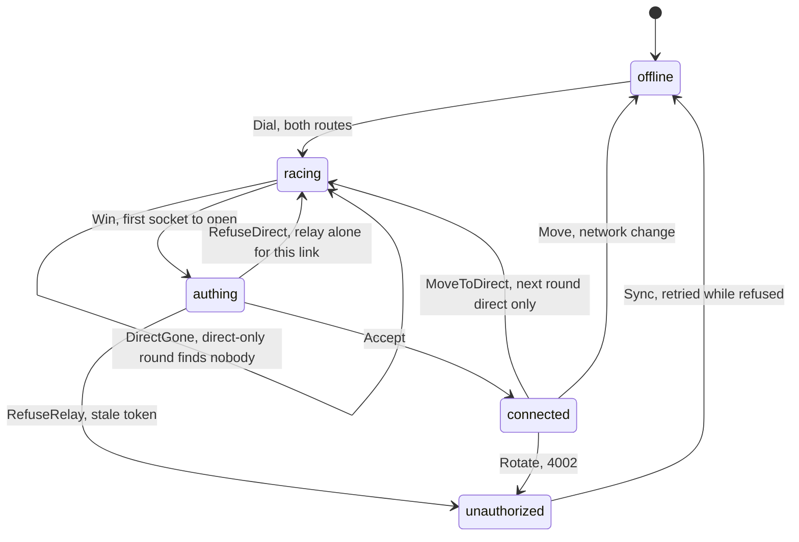

# Prefer the local network over the relay

Status: Building
Date: 2026-10-24

## Problem

Clients dial the relay first and then stick to whichever address worked last. At home, every frame between the phone and the home server goes out to Cloudflare and back: about 20 ms more per round trip, Cloudflare reads it, and nothing connects when the internet is down. A phone that connected through the relay while away keeps using it after it comes home.

## User flow

Nothing to do. At home the phone, the iPad and every desktop connect to a machine's direct address. Away, the relay answers instead, half a second later than a direct address would. Back home, the client moves to the direct address within a minute, or at once when the phone notices the network change.

## Design

`dialPlan(target)` in `src/shared/remote.ts` replaces `remoteSocketUrls`. It lists every direct address at delay 0 and the relay at `RELAY_DELAY_MS` (500 ms).

- **Race.** Each connection round opens a socket per dial after its delay. The first socket to open wins, and every other socket closes without receiving a frame, so the pairing token goes to the winner only. No socket open within the connect timeout is a lost link with the usual backoff. This replaces the sticky last-worked index on both clients.
- **Move back.** While connected over the relay, a client opens the direct dials every `DIRECT_CHECK_INTERVAL_MS` (one minute) without authenticating, waits up to `DIRECT_CHECK_TIMEOUT_MS`, and when one opens it ends the relay session and dials the direct address at once. The phone checks only in the foreground and once on returning to it, and it already races again on every network change.
- **A refusal on the direct address is not final.** Away from home, someone else's HinaCode can answer there and refuse the token. A 4001 before `ready` on the direct address, while the pairing has a relay, sends the rest of the link to the relay alone. Only the relay's refusal stops the link. A new link races both routes again.
- **The move is not a new race.** After the check finds the direct address, the next round dials it alone, so a relay that answers first cannot win the round back every minute. If nobody answers there any more, the round after races both at once.
- **A refused relay server syncs until it has the new token.** After a rotation the relay holds the new token a moment later. The desktop picks it up at its five-minute sync; the phone syncs every 15 seconds while a relay server is refused.
- The desktop does this in `Environments.maintain`, the phone in `Transport` and its relay-account store.

### State machine

`specs/RelayRouting.tla` models this link, and TLC checks it for both clients (`pnpm check:specs`).

### Trust

A direct address can belong to someone else on another network: `192.168.1.20` at a café is not your home server. A client never sends the pairing token to it: it answers the server's challenge with a proof of the token and checks the server's proof in `ready` ([ADR 0022](../adr/0022-clients-prove-the-pairing-token.md)). A stranger gets a proof it cannot reuse, and the link moves on to the relay.

## Out of scope

- Showing which route a connection uses.

## Verification

- `src/shared/remote.test.ts`: the plan lists direct addresses at once and the relay after the delay.
- `specs/RelayRouting.tla`: the client gives up only on a stale token, recovers after moves and rotations, and settles on the direct address at home, on the desktop (`RelayRouting.cfg`) and the phone (`RelayRouting.Phone.cfg`). Both also check that the token reaches the machine only (`TokenStaysWithMachine`).
- `src/main/services/Environments.integration.test.ts` and `apps/mobile/src/lib/transport.test.ts`: the direct address wins when both answer, the relay wins when the direct address does not, the loser never receives `auth`, a relay connection moves to the direct address once it answers, a stranger's refusal leaves the link on the relay, and a direct address slower than the relay does not make the link drop every minute. `apps/mobile/src/stores/relay-account.test.ts`: a refused relay server syncs until its token changes.
- By hand: a desktop instance and a `hinacode serve` instance linked to a local relay with real tunnels. The desktop connects direct. With the direct address unreachable it connects through the relay, and once the address answers again it moves back.
