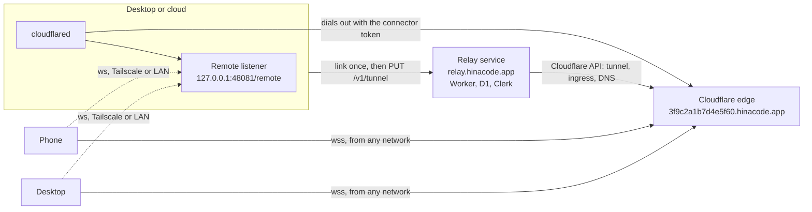

# Relay: reach HinaCode from any network

Status: Building
Date: 2026-10-24

The first deploy serves one owner. An `OWNER_TOKEN` secret stands in for Clerk: the link page asks for it once, and every page call sends it as the bearer. Tunnels use `hinacode.app` as their zone for now. Clerk and a zone of their own, as described below, come before anyone else links a machine.

## Problem

Every remote path today is direct. A phone, or a desktop driving a cloud, dials `ws://host:port` on a Tailscale or LAN address from the pairing URL. Without Tailscale, a developer who leaves home loses every paired machine. The phone on cellular cannot see the thread waiting for approval on the desktop, and the laptop at a café cannot reach the home server. Port forwarding works but puts a plain WebSocket on the public internet and needs a router the developer may not control.

The remote clouds design planned a self-hosted relay server for this (slice 3 of `2026-10-14-remote-clouds.md`). Nobody built it, because every developer would have to run one more service.

## User flow

1. Settings > Remote on the machine that runs the agents, the desktop app here. Under **Relay**, press **Turn on relay**.
2. The browser opens `relay.hinacode.app/link?code=WXYZ-2345`. The developer signs in to their HinaCode account (GitHub, Google or email, through Clerk) and approves `Link home-mac to your account`. The page lists the machines already linked, each with Remove.
3. Back in Settings, the status reads `Connecting`, then `Reachable at 3f9c2a1b7d4e5f60.hinacode.app`. Linking is once per machine.
4. The pairing QR code now carries the relay. A phone scanning it connects from any network. A phone or desktop paired before the relay existed learns it on its next connection, so nothing needs to pair again.
5. Away from home, the phone and every desktop connect through the relay first and fall back to the direct addresses when the relay cannot be reached.
6. A cloud links from its command line: `hinacode serve --relay on` prints the same link URL, waits for the approval, then prints the pairing block with the relay in it. Later boots keep it running without the flag. `--relay off` unlinks it.
7. **Remove relay** unlinks the machine. The relay service deletes its tunnel and DNS record, and clients go back to direct addresses. Turning **Allow remote control** off stops `cloudflared` but keeps the link, so turning it back on reconnects on the same hostname.

Nothing needs installing. HinaCode uses the `cloudflared` on `PATH` when there is one. Otherwise it downloads the pinned release from Cloudflare's GitHub into `<data dir>/cloudflared/<version>/`, checks its SHA-256, and keeps it for later boots. A failed download shows as the connecting error and is retried with the connector's backoff.

## Design

Three parts. The **relay service** is a Cloudflare Worker that HinaCode runs. It keeps the accounts (through Clerk) and creates one Cloudflare named tunnel per linked machine in HinaCode's Cloudflare account. The **host**, any HinaCode with remote control on, runs `cloudflared` with the connector token the service hands it. The **clients**, the phone and the desktop, dial `wss://<hostname>/remote`, and Cloudflare's edge splices them to the host. The relay service never carries a frame; it only hands out hostnames and connector tokens. The remote protocol is unchanged: `auth` first, `ready`, then calls and pushes. See [ADR 0020](../adr/0020-cloudflare-tunnel-as-the-relay.md).



### Data shape

The pairing names the relay next to the direct addresses.

```ts
// src/shared/remote.ts
interface PairingTarget {
  hosts: NonEmptyReadonlyArray<string> // direct addresses, Tailscale first
  port: number
  token: string
  relay: string | null // tunnel hostname; clients dial wss://<relay>/remote
}

// hinacode://connect?relay=3f9c2a1b7d4e5f60.hinacode.app&host=100.64.0.2&host=192.168.1.6&port=48081&token=...

ServerFrame ready += { relay?: string } // absent when the machine has no relay
```

- `remoteSocketUrls(target)` is the one place that turns a pairing into socket URLs: the relay first, then each host. Both clients use it.
- `relay` is a bare hostname, refused with a port or a path. The socket always uses `wss` on 443, which is where Cloudflare's edge listens.
- An app that predates this ignores the unknown `relay` parameter and the unknown `ready` field, so it keeps pairing over the direct addresses. No protocol version bump.

The relay service keeps two tables in D1 (`relay/migrations/`).

```sql
-- A machine waiting for its owner to approve it, as in OAuth device authorization.
CREATE TABLE link (
  device_code_hash TEXT PRIMARY KEY, -- sha256 of the code only the machine holds
  user_code TEXT NOT NULL UNIQUE,    -- WXYZ-2345, shown in the URL and on the page
  environment_id TEXT NOT NULL,
  name TEXT NOT NULL,                -- the machine's hostname, shown on the approval page
  user_id TEXT,                      -- the Clerk user, once approved
  expires_at INTEGER NOT NULL        -- 10 minutes after creation
);

-- A linked machine and its tunnel.
CREATE TABLE host (
  id TEXT PRIMARY KEY,               -- 16 random hex characters, also the hostname label
  user_id TEXT NOT NULL,
  environment_id TEXT NOT NULL,
  name TEXT NOT NULL,
  credential_hash TEXT NOT NULL UNIQUE, -- sha256 of the bearer the machine holds
  tunnel_id TEXT,
  dns_record_id TEXT,
  created_at INTEGER NOT NULL,
  UNIQUE (user_id, environment_id)
);
```

Clerk stores the accounts. The service stores only the Clerk user id, never an email or a name.

The host keeps one setting row and two secrets.

```ts
// setting row "relay.tunnel", JSON
RelayTunnel = { hostname, origin } // origin: the ingress target last sent to the service

// Secrets
;("relay.credential") // the bearer for the relay service
;("relay.connectorToken") // cloudflared's TUNNEL_TOKEN, so boot needs no call to the service
```

What the settings page reads, in `RemoteStatus.relay`:

```ts
RelayStatus =
  | { state: "off" } // not linked
  | { state: "linking"; url; userCode } // waiting for the owner to approve in a browser
  | { state: "paused"; hostname } // the remote listener is off
  | { state: "connecting"; hostname; error: string | null } // started, or restarting after `error`
  | { state: "connected"; hostname }
```

A union over `state` keeps a hostname out of `off` and an error out of `connected`, so the page cannot render `Reachable` with a stale failure next to it.

### Relay service: `relay/`

A Hono app on Cloudflare Workers, deployed like the site (`pnpm --dir relay deploy`) to `relay.hinacode.app`. Bindings: D1 `DB`, the secrets `CLOUDFLARE_API_TOKEN` (Account, Cloudflare Tunnel, Edit and Zone, DNS, Edit on the tunnel zone) and `CLERK_SECRET_KEY`, and the variables `CLOUDFLARE_ACCOUNT_ID`, `TUNNEL_ZONE_ID`, `TUNNEL_ZONE_NAME` and `CLERK_PUBLISHABLE_KEY`.

| Method and path            | Caller             | Does                                                                                       |
| -------------------------- | ------------------ | ------------------------------------------------------------------------------------------ |
| `POST /v1/links`           | machine            | `{ environmentId, name }` → `{ deviceCode, userCode, url, interval, expiresAt }`           |
| `GET /link?code=`          | browser            | The page: Clerk sign-in, `Link <name>?` with Approve, and the account's machines           |
| `GET /v1/links/:userCode`  | page, Clerk bearer | `{ name, environmentId }` for the approval prompt                                          |
| `POST /v1/links/:userCode` | page, Clerk bearer | Approves. Refuses past 5 machines per account                                              |
| `POST /v1/links/claim`     | machine            | `{ deviceCode }` → 202 while pending, then `{ credential }` once, and the link row is gone |
| `PUT /v1/tunnel`           | machine bearer     | `{ origin }` → `{ hostname, connectorToken }`, creating or updating the tunnel             |
| `DELETE /v1/host`          | machine bearer     | Deletes the DNS record, the tunnel and the row                                             |
| `GET /v1/hosts`            | page, Clerk bearer | The account's machines                                                                     |
| `DELETE /v1/hosts/:id`     | page, Clerk bearer | Same as `DELETE /v1/host`, for a machine the developer no longer has                       |

- Approving the same machine again (same user and environment id) replaces its credential and keeps its id, tunnel and hostname, so a re-link never orphans a tunnel and the old credential stops working.
- `PUT /v1/tunnel` converges from any partial state: it looks the tunnel up by name (`hinacode-<host id>`) before creating it, pushes the ingress `<host id>.<zone> -> origin` and `http_status:404` for everything else, updates the CNAME `<tunnel id>.cfargotunnel.com` or creates it proxied, and returns the connector token. `origin` must be `http://<address>:<port>` with no path.
- The Clerk bearer is a session token from Clerk's browser SDK on the link page, checked with `@clerk/backend` `verifyToken` against the page's own origin. The machine bearer is 32 random bytes, stored as its SHA-256.
- Auth and the Cloudflare API reach the app as injected functions, so the tests run the real handlers and D1 with a fake Cloudflare and a fake Clerk.

### Host: `src/main/remote/relay.ts`

`Relay` is an Effect service below the remote listener. It owns linking, unlinking and the `cloudflared` child, and reports its status and hostname to `RemoteAccess`, which already answers `remote.status` and `remote.pairing`. The service URL is `https://relay.hinacode.app`, or `HINACODE_RELAY_URL` for a local `wrangler dev` or a self-hosted service.

- **Setup** (`remote.setupRelay`). Without a credential it calls `POST /v1/links`, reports `linking` with the URL, and claims every `interval` seconds until it gets the credential or the code expires. With the credential it calls `PUT /v1/tunnel` with the origin, stores the row and the connector token, and starts the connector. The renderer opens the URL as soon as the call returns. The origin is `http://127.0.0.1:<port>`, or `http://<bindHost>:<port>` when the listener binds one address, since `cloudflared` must reach it locally.
- **Remove** (`remote.removeRelay`) stops the connector or the pending link, calls `DELETE /v1/host`, and clears the row and the secrets. A 401 or 404 from the service counts as already unlinked.
- **Connector.** While the row exists and `settings.remote.enabled` is on, it runs `cloudflared tunnel --no-autoupdate --metrics 127.0.0.1:0 run` with `TUNNEL_TOKEN` in the environment, never in argv. It reads stderr line by line: `Registered tunnel connection` means `connected`, the last `ERR` line becomes `error`, and an exit restarts it after 1 s, doubling up to 60 s, reset once it has stayed up for a minute. `ENOENT` on the `PATH` name downloads the pinned release (`src/main/remote/cloudflared.ts`) and starts that instead. Bumping `CLOUDFLARED_VERSION` with its URLs and checksums is the whole upgrade. Turning remote off or removing the relay interrupts it, which kills the child.
- **Origin moves.** When the listener's port or bind host changes, the connector calls `PUT /v1/tunnel` with the new origin before it restarts.
- The two new methods are in `desktopOnlyMethods`, like `remote.pairing` and `remote.rotateToken`. How a machine is reached is decided on that machine: in the desktop's settings, or on a cloud's command line.

### Listener

`ready` carries `relay` from `RemoteAccess`. Nothing else changes. The tunnel delivers each socket from `127.0.0.1`, and the listener already trusts no address, only the token in the first frame.

### Clients

Both clients put the relay first. It answers from every network, while a direct address off its network costs a full connect timeout before the next one is tried.

- **Phone** (`apps/mobile/src/lib/stored-target.ts`, `connection.ts`). `StoredServer` gains `relay`, absent in older entries and read as null. The `Transport` gets `remoteSocketUrls(server)`. A `ready` whose `relay` differs from the stored one updates the entry, which reopens the transport with the new URL list. Pairing again matches an entry by relay as well as by shared host.
- **Desktop** (`services/Environments.ts`). The `environment` table gains `relay` (migration `0021`). The connection walks `remoteSocketUrls(environment)`: a session that ends before `ready` moves on to the next URL, and a session that reached `ready` starts again from the one that worked. A `ready` with a different `relay` updates the row. `environments.add` probes the relay alongside the hosts and keeps the earliest direct host that answered, or the first host when only the relay did.

### Trust boundary

- **Accounts.** Clerk holds them. The relay service holds a Clerk user id per linked machine, the machine's hostname as its name, and hashes of credentials. It never sees a frame, a transcript or a pairing token.
- **Linking** follows OAuth device authorization. The device code never leaves the machine, and the page names the machine before the developer approves it, so a code sent by someone else shows a machine the developer does not recognise.
- **Cloudflare terminates TLS**, so Cloudflare can read frames in transit, the pairing token in `auth` included. That is the same trade as any Cloudflare-proxied site. End-to-end encryption with the host key pinned in the pairing URL is the hardening step if it stops being acceptable.
- **The hostname is public**, and anyone can open a socket on it. The listener gives an unauthenticated socket 5 seconds and one frame, and the token is 32 random bytes compared with `timingSafeEqual`, so a public endpoint adds load, not access.
- **Abuse.** A tunnel hostname serves whatever the linked machine answers, under HinaCode's zone. Accounts, the limit of five machines, and Clerk's ban make that traceable and stoppable. Tunnels live on a zone of their own (`TUNNEL_ZONE_NAME`), so a hostile page never shares an origin with `hinacode.app`.
- Every answer from Cloudflare and from the relay service is decoded with a schema before it is read, on both sides.

## Out of scope

- Bringing your own Cloudflare account. A self-hosted relay service (`HINACODE_RELAY_URL`) covers that case without a second setup path in the app.
- Reaping tunnels of machines that never come back. Removing them from the link page is the manual path.
- Automation webhooks through the relay. Another ingress rule (`/hooks/*` to the webhook port) would give each machine a public webhook URL, and the HMAC check would stay as it is.
- End-to-end encryption on top of the tunnel, and moving back from the relay to a direct address while the relay still works.

## Verification

- `src/shared/remote.test.ts`: the pairing URL round-trips `relay`, refuses a relay with a port or a path, and an old URL without it parses with `relay: null`. `remoteSocketUrls` puts the relay first.
- `relay/test/`: the handlers against real D1 in workerd, a fake Cloudflare and a fake Clerk. A link is pending until approved and claimable once. A sixth machine is refused. Re-approving keeps the tunnel and revokes the old credential. `PUT /v1/tunnel` converges after a failure partway. Unlinking tolerates a tunnel Cloudflare already deleted.
- `src/main/remote/relay.integration.test.ts`: linking against a stand-in relay service, and the connector against a stand-in `cloudflared` script on `PATH`. It reports `linking`, `connecting`, then `connected` on the registration line, restarts after an exit, downloads a stand-in release when the binary is missing and refuses one with the wrong checksum, and passes the token in the environment, not argv.
- `src/main/services/Environments.integration.test.ts`: a desktop whose relay URL fails falls back to the host, and a `ready` with a relay updates the row.
- `apps/mobile/src/lib/stored-target.test.ts` and `connection.test.ts`: older entries read with `relay: null`, a learned relay reopens the transport, and the relay is dialed first.
- By hand, with `wrangler dev`, a Clerk development instance and a real Cloudflare zone: an isolated HinaCode turns on the relay from Settings > Remote, and the link page signs in and approves it. A second isolated HinaCode pairs with it from a URL whose only direct host is an address that never answers (`192.0.2.1`, reserved for documentation), so the relay is the one path that works. It lists the first one's projects and runs a thread there. Then Remove relay deletes the tunnel and the record.
