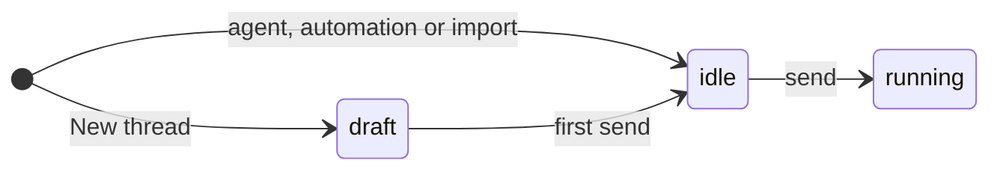

# New threads are drafts until their first message

Status: Shipped
Date: 2026-11-01

## Problem

New thread saved a listed thread before the developer typed anything. Clicking New thread to look around, or in the wrong project, left `thread-xxxxx` rows in the sidebar to delete by hand.

## How others do it

t3code and bb keep a new thread as a client draft and create the thread with its first turn in one request. t3code keeps one draft per project and reuses it while it is empty.

## User flow

1. The developer clicks New thread in a project. The composer opens under the title New thread, and the sidebar does not change.
2. They type half a message and open another thread. Clicking New thread in the same project brings the draft back with the text, on the desktop or the phone.
3. They pick another project in the composer heading. The text moves to that project's draft.
4. They send. The draft becomes a thread at the end of its project in the sidebar, and the next New thread in that project opens a fresh draft.

## Design

A draft is a thread row in the `draft` status, so the composer, attachments, the agent picker and rpc routing to other machines work on it unchanged.

- `threads.draft({ projectId })` returns the project's draft created by `user`, or creates it. A reused draft takes the remembered new-thread options again, so it starts as the last new thread was set up.
- `AgentRunner` turns a draft into an `idle` thread inside the first send's lock, before workspace preparation. The thread takes the project's next sort index and a new `createdAt`, so it lands where a brand new thread would.
- Only `threads.draft` makes drafts. Automations, imports, forks and `create_thread` still create `idle` threads.
- `threads.list` still returns drafts, so other clients can open them. The desktop keeps them in a separate `drafts` map beside `byId` and `sidechats`, so every list, the palette, mentions and the thread switcher leave them out. The phone filters them with `listedThreads`. `list_threads` and mention candidates skip them.
- Moving a draft to another project carries its text and comments to that project's draft and leaves the first one empty. Its workspace and attachments stay behind, because they belong to the first project.

## Out of scope

- Keeping a draft's text across restarts. The composer draft store lives in memory, so a reused draft comes back empty after a restart.

## Verification

- `ipc.integration.test.ts` covers one draft per project, the first send listing it, and a reused draft taking the remembered options. `Threads.integration.test.ts` covers the sort index after the first send. `threadDraft.integration.test.ts` covers the migration. `stores/threads.test.ts` covers keeping drafts out of the lists.
- `e2e/features/threads.feature` covers the draft staying out of the sidebar and coming back with its text.
- In the app: open New thread, type, leave and come back; move the draft to another project; send and see the thread listed; restart and see the draft still hidden and reused.
