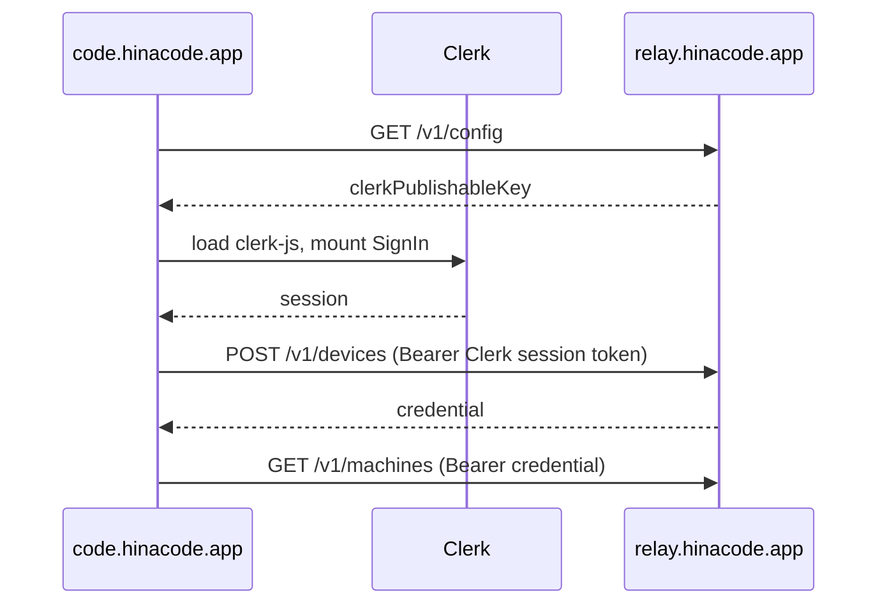

# Sign in on the web app

## Problem

The web app at `code.hinacode.app` signs in the way a phone does. It opens the relay's `/link` page in a new tab, the person signs in there, presses Approve, and the web app polls the relay every five seconds until it can claim a credential. The person is already in a browser, so the second tab, the Approve click and the polling buy nothing.

## User flow

1. The person opens `code.hinacode.app`. The gate shows the HinaCode card with Clerk's sign-in inside it, the same card the relay's own pages use.
2. They pick GitHub or Google. Clerk sends them through the provider and back to `code.hinacode.app`.
3. The web app trades the Clerk session for a device credential and loads the machines. No second tab, no Approve.

Signing out of the web app ends the device credential and the Clerk session, so the gate does not sign the person straight back in.

## Design

- `GET /v1/config` returns the relay's Clerk publishable key. The web app asks the relay instead of baking a key into its build, so pointing it at another relay still works when that relay's Clerk instance allows the web origin.
- `POST /v1/devices` takes a Clerk session token, never a device credential, so a device cannot mint another device. It returns the same kind of credential a claimed sign-in does, so everything after sign-in stays as it was.
- The relay accepts Clerk tokens whose authorized party is the relay itself or one of `WEB_ORIGINS`.
- The web app loads clerk-js from the Clerk frontend host, as the relay pages do, so Clerk stays out of the desktop bundle and loads only on the gate.

## Out of scope

- The desktop and phone keep the redirect sign-in from `docs/features/2026-11-06-sign-in-redirect.md`.
- `hinacode serve` keeps the device-code flow. It runs on machines without a browser, often over SSH, where the person opens the printed URL in any browser. Nothing has to reach the machine, so it needs no callback and no pasted token.
- **Sign out all devices** ends device credentials, not Clerk sessions. A web app whose Clerk session is still alive signs in again on the next visit.
- Choosing another relay saves it for the tab and reloads the page, because clerk-js runs one Clerk instance per page.
- The web app's CSP allows Clerk scripts only from `clerk.hinacode.app` and Clerk development hosts. Another relay whose Clerk production instance lives elsewhere needs its own build of the web app.

## Verify

- Relay tests cover `GET /v1/config`, `POST /v1/devices`, and that a device credential cannot call it.
- The web e2e serves a stand-in Clerk script and drives the gate through sign-in to the machine list and back out.
- Against a Clerk development instance, `pnpm dev` in `relay/` and the web app with `VITE_RELAY_URL=http://localhost:8787` sign in with a real provider.
