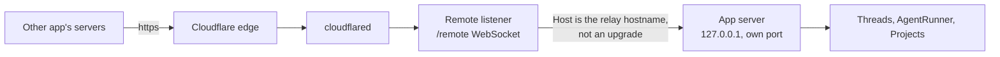

# App connections: drive HinaCode from another app

Status: Building
Date: 2026-11-10

## Problem

A developer away from the desk talks to a chat app or an agent harness that speaks remote MCP: Claude, ChatGPT, Grok Bot, Hermes Agent. That app cannot see or steer HinaCode threads. The built-in MCP server listens on loopback and each credential belongs to one thread, so it only serves agents that HinaCode started itself.

Running something inside the other app's sandbox does not work either. Those sandboxes restrict outbound traffic, and remote MCP calls are made from the vendor's servers, not from the sandbox. The endpoint has to be a public https URL that signs in with OAuth.

## User flow

1. The machine is linked to the relay (`2026-10-24-relay.md`). Settings > Connections shows **Apps** with the URL `https://<hostname>/mcp` and a Copy button.
2. The developer adds that URL as a remote MCP server in the other app and picks OAuth.
3. The other app opens the sign-in page, served by the developer's own machine through the tunnel. It names the app and asks for an approval code.
4. In Settings, **New code** shows a one-time code for ten minutes. The developer types it on the page and approves.
5. The app appears in the list in Settings with when it connected and when it was last used. Remove ends its access at once.
6. The app can now list projects and threads, read a thread, start one, send to one and stop one.

Without a relay the section says to link this machine first.

## Design

Two MCP servers, because the caller is a different kind of thing. See [ADR 0025](../adr/0025-a-second-mcp-server-for-outside-apps.md).

| | Thread server | App server |
| --- | --- | --- |
| Caller | An agent HinaCode started | An app the developer connected |
| Reached at | `127.0.0.1:<port>/mcp` | `https://<relay hostname>/mcp` |
| Credential | Bearer bound to one thread, in memory | OAuth access token, stored hashed |
| Scope | The calling thread and its project | Every project on this machine |
| Tools | Thread, secret, review, PR, Linear, VM, device, artifact tools | Project and thread tools only |



The tunnel's ingress already points at the remote listener, so the relay service does not change. The listener forwards plain HTTP requests whose `Host` is the relay hostname to the app server on loopback, and answers 404 to everything else as before. The issuer is always `https://<relay hostname>`, taken from the relay status and never from a forwarded header.

The surface exists only while it is in use. With no live approval code and no connected app, every path answers 404, so a linked machine that never uses this exposes nothing new.

### Data shape

```sql
-- src/main/db/migrations/0046_app_connection
CREATE TABLE app_connection (
  id TEXT PRIMARY KEY,
  name TEXT NOT NULL,              -- client_name from registration, shown in Settings
  token_hash TEXT NOT NULL UNIQUE, -- sha256 of the access token
  created_at TEXT NOT NULL,
  last_used_at TEXT
);
```

```ts
// src/shared/domain.ts
AppConnection = { id, name, createdAt, lastUsedAt: string | null }
AppConnectionsStatus = {
  url: string | null // null until the relay has a hostname
  approvalCode: { code: string; expiresAt: string } | null
  connections: AppConnection[]
}

// src/shared/contract.ts
"appConnections.status": rpc(Void, AppConnectionsStatus)
"appConnections.newApprovalCode": rpc(Void, AppConnectionsStatus)
"appConnections.remove": rpc({ id }, AppConnectionsStatus)
// event: { type: "appConnections.changed", status }
```

In memory only, so a restart drops them: the one live approval code with its remaining attempts, and authorization codes waiting to be exchanged.

### OAuth

The app server is its own authorization server, as the MCP authorization spec expects of a remote server.

| Path | Does |
| --- | --- |
| `GET /.well-known/oauth-protected-resource` (also `/mcp` suffixed) | Names the resource and the issuer |
| `GET /.well-known/oauth-authorization-server` | Endpoints, `S256`, `authorization_code`, public clients |
| `POST /oauth/register` | Dynamic client registration. The `client_id` is the client's name and redirect URIs, signed with a key from `Secrets`, so nothing is stored for a client that never finishes |
| `GET /oauth/authorize` | The approval page: the app's name, the host it redirects to, a code field |
| `POST /oauth/authorize` | Checks the approval code, then redirects with an authorization code |
| `POST /oauth/token` | Checks PKCE and the redirect URI, inserts the `app_connection`, returns the token |
| `/mcp` | 401 with `WWW-Authenticate: Bearer resource_metadata=...` without a valid token |

- PKCE with `S256` is required. Redirect URIs must be https, or http on loopback.
- An authorization code lives 60 seconds and works once.
- An approval code is 8 characters from a 32 letter alphabet, lives ten minutes, works once, and is thrown away after 5 wrong tries.
- Access tokens do not expire. Remove in Settings is the way to end one. There are no refresh tokens.
- A registered redirect URI must match exactly, except the port of a loopback one.

### Tools

`list_projects`, `list_threads({ projectId? })`, `search_threads`, `read_thread`, `create_thread({ projectId, title, prompt, provider?, model?, effort?, worktree? })`, `send_to_thread`, `stop_thread`.

They share the rendering of the thread server's tools and not their scoping: there is no calling thread, so `create_thread` names its project and threads are created with `created_by = app:<connection id>`.

## Out of scope

- Answering approvals, questions and secret requests from the other app. `read_thread` says what a thread waits on.
- Threads on the developer's other machines. Each machine has its own URL.
- Read-only connections, per-project access and token expiry.
- Approving from the phone app.
- A catalog of apps with one-click setup. Settings shows the URL.

## Verify

- `src/main/apps/server.integration.test.ts` walks registration, approval, token exchange and a tool call over real HTTP, and covers a wrong code, a reused authorization code, a bad PKCE verifier, a removed connection and the 404 surface.
- In the real app (`verify-hinacode`): the Apps section with a URL, a new code, and a connected app after driving the OAuth flow with `curl`.
