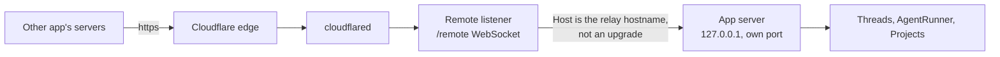

# App connections: drive HinaCode from another app

Status: Shipped
Date: 2026-11-10

## Problem

A developer away from the desk talks to a chat app or an agent harness that speaks remote MCP: Claude, ChatGPT, Grok Bot, Hermes Agent. That app cannot see or steer HinaCode threads. The built-in MCP server listens on loopback and each credential belongs to one thread, so it only serves agents that HinaCode started itself.

Running something inside the other app's sandbox does not work either. Those sandboxes restrict outbound traffic, and remote MCP calls are made from the vendor's servers, not from the sandbox. The endpoint has to be a public https URL that signs in with OAuth.

## User flow

1. The machine is linked to the relay (`2026-10-24-relay.md`). Settings > Connections > **Apps** shows the URL `https://<hostname>/mcp`, a **Copy URL** button and one line: copy the URL, add it to your app as a custom MCP connector, then approve the request here.
2. **Copy URL** copies it and makes HinaCode wait ten minutes for an app to sign in. The developer adds it in Grok Bot, Claude, ChatGPT or any app that takes a remote MCP server with OAuth.
3. The app registers and sends the developer's browser to the authorize page, which the developer's own machine serves through the tunnel. It names the app, lists what approving lets it do, and offers **Sign in to approve**.
4. The developer either signs in on the relay, which returns to the page with Approve and Deny and "Signed in as <email>", or answers `<app> wants to connect` in Settings. The page refreshes every two seconds until one of them answers.
5. After Approve, the page redirects to the app's callback with an authorization code. The app exchanges it, and appears in the list with when it was last used. Remove ends its access at once.
6. The app can now list projects and threads, read a thread, start one, send to one and stop one.

Without a relay the section says to sign in to the relay first. Apps connected earlier stay listed, so they can still be removed.

## Design

Two MCP servers, because the caller is a different kind of thing. See [ADR 0025](../adr/0025-a-second-mcp-server-for-outside-apps.md).

|            | Thread server                                                  | App server                        |
| ---------- | -------------------------------------------------------------- | --------------------------------- |
| Caller     | An agent HinaCode started                                      | An app the developer connected    |
| Reached at | `127.0.0.1:<port>/mcp`                                         | `https://<relay hostname>/mcp`    |
| Credential | Bearer bound to one thread, in memory                          | OAuth access token, stored hashed |
| Scope      | The calling thread and its project                             | Every project on this machine     |
| Tools      | Thread, secret, review, PR, Linear, VM, device, artifact tools | Project and thread tools only     |



The tunnel's ingress already points at the remote listener, so the relay service does not change. The listener forwards plain HTTP requests whose `Host` is the relay hostname to the app server on loopback, and answers 404 to everything else as before. The issuer is always `https://<relay hostname>`, taken from the relay status and never from a forwarded header.

The surface exists only while it is in use. While HinaCode is not waiting for an app and none is connected, every path answers 404, so a linked machine that never uses this exposes nothing new.

### Data shape

```sql
-- src/main/db/migrations/0046_app_connection
CREATE TABLE app_connection (
  id TEXT PRIMARY KEY,
  name TEXT NOT NULL,              -- client_name from registration, shown in Settings
  token_hash TEXT NOT NULL UNIQUE, -- sha256 of the access token
  created_at TEXT NOT NULL,
  last_used_at TEXT
);
```

```ts
// src/shared/domain.ts
AppConnection = { id, name, createdAt, lastUsedAt: string | null }
AppConnectionsStatus = {
  url: string | null // null until the relay has a hostname
  waitingUntil: string | null // set by choosing an app, cleared by an approval or after ten minutes
  requests: { id: string; name: string; redirectHost: string }[] // apps waiting for Approve or Deny
  connections: AppConnection[]
}

// src/shared/contract.ts
"appConnections.status": rpc(Void, AppConnectionsStatus)
"appConnections.start": rpc(Void, AppConnectionsStatus)
"appConnections.answer": rpc({ id, approve }, AppConnectionsStatus)
"appConnections.remove": rpc({ id }, AppConnectionsStatus)
// event: { type: "appConnections.changed", status }
```

In memory only, so a restart drops them: the waiting window, requests waiting for an answer, and authorization codes waiting to be exchanged.

### OAuth

The app server is its own authorization server, as the MCP authorization spec expects of a remote server.

| Path                                                               | Does                                                                                                                                                                         |
| ------------------------------------------------------------------ | ---------------------------------------------------------------------------------------------------------------------------------------------------------------------------- |
| `GET /.well-known/oauth-protected-resource` (also `/mcp` suffixed) | Names the resource and the issuer                                                                                                                                            |
| `GET /.well-known/oauth-authorization-server`                      | Endpoints, `S256`, `authorization_code`, public clients                                                                                                                      |
| `POST /oauth/register`                                             | Dynamic client registration. The `client_id` is the client's name and redirect URIs, signed with a key from `Secrets`, so nothing is stored for a client that never finishes |
| `GET /oauth/authorize`                                             | While waiting, records the request, shows it in Settings and redirects to `/oauth/wait`. Otherwise says to start in HinaCode                                                 |
| `GET /oauth/sign-in?request=`                                      | Sets a sign-in cookie and sends the browser to the relay's `/sign-in` with a PKCE challenge and `redirect_uri=https://<hostname>/oauth/signed-in`                            |
| `GET /oauth/signed-in?code=`                                       | Redeems the code with the relay using the machine's host credential, then sets an owner cookie bound to the request                                                          |
| `POST /oauth/answer`                                               | Approve or Deny from the page, accepted only with that owner cookie                                                                                                          |
| `GET /oauth/wait?request=`                                         | Waits for Approve or Deny, refreshing every two seconds, then redirects to the app with a code or `access_denied`                                                            |
| `POST /oauth/token`                                                | Checks PKCE and the redirect URI, inserts the `app_connection`, returns the token                                                                                            |
| `/mcp`                                                             | 401 with `WWW-Authenticate: Bearer resource_metadata=...` without a valid token                                                                                              |

- PKCE with `S256` is required. Redirect URIs must be https, or http on loopback.
- An authorization code lives 60 seconds and works once.
- Cookies are `HttpOnly; Secure; SameSite=Lax; Path=/oauth`, live ten minutes, and the owner cookie answers only its own request. The relay never turns these codes into device credentials.
- Choosing an app waits ten minutes. At most five requests wait at once. Approving one ends the wait and turns the others away.
- Access tokens do not expire. Remove in Settings is the way to end one. There are no refresh tokens.
- A registered redirect URI must match exactly, except the port of a loopback one.
- A `/mcp` request must declare its length and stay under 1 MB. OAuth bodies stay under 64 KB.

### Tools

`list_projects`, `list_threads({ projectId? })`, `search_threads`, `read_thread`, `wait_for_thread` (holds the call up to a minute until the turn ends, so the app does not poll), `create_thread({ projectId, title, prompt, provider?, model?, effort?, worktree? })`, `send_to_thread`, `stop_thread`.

They share the rendering of the thread server's tools and not their scoping: there is no calling thread, so `create_thread` names its project and threads are created with `created_by = app:<connection id>`.

## Out of scope

- Answering approvals, questions and secret requests from the other app. `read_thread` says what a thread waits on.
- Threads on the developer's other machines. Each machine has its own URL.
- Read-only connections, per-project access and token expiry.
- Approving from the phone app.
- Per-app buttons that open each app's connector form. Settings shows one instruction for every app.

## Verify

- `src/main/apps/server.integration.test.ts` walks registration, approval, token exchange and a tool call over real HTTP, and covers an authorize request before choosing an app, a denial, competing requests, a reused authorization code, a bad PKCE verifier, a removed connection and the 404 surface.
- In the real app (`verify-hinacode`): choose an app, drive the OAuth flow with `curl`, approve in Settings, and see the connected app.
