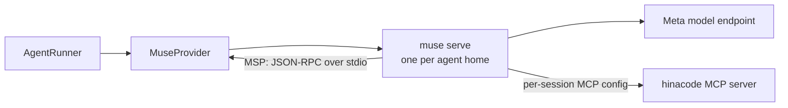
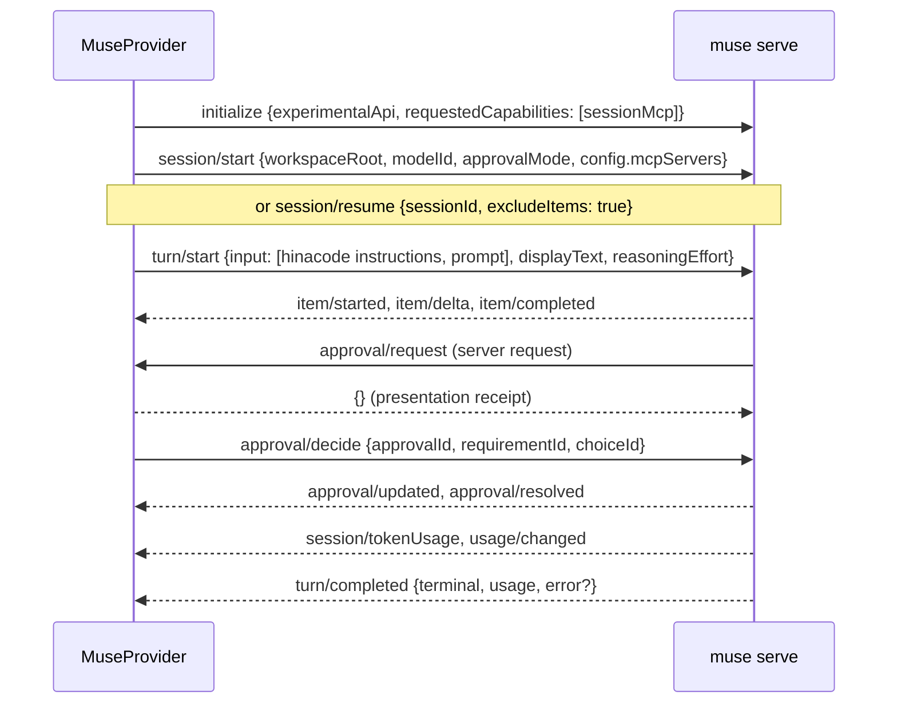

# Muse Code integration guide

How hinacode drives Meta's Muse Code agent, what the protocol does that its reference does not say, and how to change or test the integration. Read it before you touch `src/main/agents/muse/`. [features/2026-10-13-muse-code.md](features/2026-10-13-muse-code.md) describes the feature itself.

## Muse Code and its models

Muse Code is Meta's coding agent for the terminal and CI. Install it with `curl -fsSL https://dev.meta.ai/install.sh | sh`, then sign in with `muse login` (a device code in the browser) or set `META_API_KEY`.

| Model            | Id                                 | Where it runs                                                               |
| ---------------- | ---------------------------------- | --------------------------------------------------------------------------- |
| Muse Wonder      | `muse-wonder-1.0`                  | Muse Code on any plan, and the pay-as-you-go Model API (Standard mode only) |
| Muse Wonder Full | `muse-wonder-full-1.0`             | Muse Code only, on the Power Usage and Maximum Usage plans                  |
| Muse Spark       | `muse-spark-1.3`, `muse-spark-1.2` | Muse Code and the Model API                                                 |

Muse Wonder is in preview. Setting `max` effort on Muse Wonder does not select Muse Wonder Full; they are separate models. hinacode never hard-codes these ids. It lists what the signed-in plan offers with `model/list`. Source: [dev.meta.ai models](https://dev.meta.ai/docs/models#muse-wonder-availability).

## The pieces

- `muse serve` is an MSP (Muse Session Protocol) host. The client owns its stdin and stdout, and one host holds many sessions. Startup is about 200 ms and the idle process takes about 120 MB.
- `@muse-code/sdk` is the TypeScript client. hinacode uses `spawnMspConnection` and the raw `Connection`. `request` sends a read, and `command` mints the idempotent `commandId` that state-changing methods need. hinacode skips the `MuseClient` facade, which keeps the connection's one notification handler for itself, drops frames without a `sessionId` such as `usage/changed`, and has no steer, interrupt, model or approval-mode calls.
- The wire types ship inside the SDK at `@muse-code/sdk/dist/src/msp.js`, for type imports only. `muse schema generate-ts --out DIR --experimental` prints the experimental methods too, including `account/read`.

| File in `src/main/agents/muse/`            | What it holds                                                                                              |
| ------------------------------------------ | ---------------------------------------------------------------------------------------------------------- |
| `host.ts`                                  | Spawns `muse serve`, runs the handshake, fans frames out to subscribers, answers server requests with `{}` |
| `index.ts`                                 | The `AgentProvider`: one host, sessions, turns, approvals, questions, steer, Stop, access modes            |
| `protocol.ts`                              | Type re-exports, and the schemas for answers that reach hinacode's own types                               |
| `catalog.ts`, `limits.ts`                  | Models, account and plan limits                                                                            |
| `items.ts`, `approvals.ts`, `questions.ts` | Pure mappings from MSP items, approvals and questions                                                      |
| `skills.ts`                                | Slash completions and typed skill invocations                                                              |
| `usage.ts`                                 | Thread tokens from `view/page`, memoized per session                                                       |
| `subagents.ts`                             | A parent session's `subagent` items as Agents tab rows                                                     |
| `backgroundTasks.ts`                       | The background task set after a `toolCall` item changes                                                    |

## A turn

| MSP                                          | hinacode event                                                               |
| -------------------------------------------- | ---------------------------------------------------------------------------- |
| `session/start` or `session/resume` result   | `session_bound` with the session id                                          |
| `item/delta` field `text`                    | `text_delta`                                                                 |
| `item/delta` field `summary.N`               | `reasoning_delta`, one paragraph per part                                    |
| `toolCall` item started and completed        | `tool_call_started`, `tool_call_finished`                                    |
| completed `write_file` or `edit_file`        | `file_changed` with the path                                                 |
| `subagent` item started, updated, completed  | `subagent_updated` with the full row                                         |
| `approval/request`                           | `approval_requested`; `approval/resolved` gives `approval_resolved`          |
| `userInput/request`                          | `question_requested`; `userInput/settled` gives `question_resolved`          |
| `turn/completed` `completed`                 | `turn_completed` with the turn's usage and the latest `session/contextUsage` |
| `turn/completed` `cancelled`                 | `turn_failed` "Turn interrupted"                                             |
| `turn/completed` `failed` with `error.quota` | `turn_limited`; other failures give `turn_failed`                            |

hinacode renames Muse's tools to the names the transcript has icons for. `bash` becomes `Bash`, `read_file` becomes `Read`, `write_file` becomes `Write`, `edit_file` becomes `Edit`, `search` becomes `Grep`, and `web_fetch` and `web_search` become `WebFetch` and `WebSearch`. `bash` reports a JSON receipt whose `output` field is what the command printed.

MSP has no developer-instructions field, so hinacode prepends its instructions to ordinary text turns. `displayText` keeps them out of Muse's own transcript. Skill turns omit that text, so a thread started with a skill receives hinacode's instructions on its next ordinary text turn.

Each session's `config.mcpServers` carries the hinacode MCP server with the thread's own credential, which needs the `sessionMcp` capability from the handshake. Muse treats that server as required. If it cannot reach it, every turn fails with `Required MCP server 'hinacode' failed during startup`.

## Slash skills

`skill/list` needs a loaded session. The composer asks the thread's own loaded session, another session in the same cwd, or a cached probe session for that cwd. A probe never runs a turn. When the host respawns, hinacode resumes the probe instead of starting another.

A new turn beginning with a known `/selector` uses a structured `skill` input with its remaining text as `arguments`. The host expands the skill. Images remain image parts; attached-file and selected-element notes join the arguments. Unknown selectors stay plain text.

Muse 1.4.7 rejects `skill` parts on `turn/steer` with `invalidParams`: `turn/steer does not accept skill parts; submit on turn/start`. The SDK's shared input type does not express this constraint. Steering keeps slash prompts as ordinary text and sends attachments through the existing text and image conversion. To request host skill expansion, send the slash command as a new turn.

## Access modes and the sandbox

Each access mode is one of Muse's built-in permission profiles, and the composer shows Muse's own name and description for it on a Muse thread. A profile sets the filesystem sandbox, the network and the approval mode together.

| hinacode    | Muse profile                   | Behavior measured against `muse` 1.4.13                                                        |
| ----------- | ------------------------------ | ---------------------------------------------------------------------------------------------- |
| Supervised  | `:ask-me` (Ask me)             | Runs freely in the sandbox; asks before writing outside the workspace and before each new host |
| Auto        | `:auto-review` (Auto-review)   | Same access as Ask me; an AI reviewer decides the requests a human would see                   |
| Full access | `:unrestricted` (Unrestricted) | No sandbox, `allowAll`, network enabled; writes anywhere and reaches any host without asking   |

`session/start` and `session/resume` take the profile as `permissionProfile`, and `session/setPermissionProfile` (experimental) changes it on a loaded session, so a running turn takes the new profile at once. `permissionProfile/list` serves the catalog with the labels and descriptions Muse's TUI picker shows. Muse also has `:read-only`, which hinacode does not offer yet.

Under `:unrestricted` Muse refuses a call that still asks for `sandbox_permissions: "require_escalated"` with `tool denied: unsandboxed execution requires human approval, but approval prompts are disabled`. With the sandbox off a command never needs to ask, so this only happens when a model asks anyway.

The profile overrides the host's `--sandbox-network` flag, so hinacode starts the host with Muse's defaults.

`--trust-workspace` loads the project's skills and rules, because importing a project trusts it ([ADR 0008](adr/0008-import-trusts-the-project.md)).

## Approvals

- The server request `approval/request` and the view event `approval/requested` carry the same payload. The client answers the request with `{}`, a receipt that it showed the approval, and the receipt changes nothing. The decision is a separate `approval/decide` command naming one of `availableChoices` and the current `requirementId`.
- hinacode picks the choice by its `decision`, not its id. "Allow" sends `approved`, "Allow for session" sends `approvedForSession` and falls back to `approved`, and "Deny" sends `denied` or `abort`. Shell stages offer no session choice, so hinacode also keeps its own session grant for the exact command, as it does for Claude. [ADR 0009](adr/0009-scoped-session-approvals.md) explains why a grant covers only that command.
- A compound shell command is one approval with one stage per segment. Deciding a stage acks `terminal: false`, then Muse 1.4.7 sends `approval/updated` with `change.kind: "stageResolved"` and the next `currentRequirementId`. It does not re-issue `approval/request`, although MSP's reference says it does. hinacode answers every stage with the user's one decision, from either frame, and never answers a stage twice, since a repeat gets `approvalAlreadyResolved`.
- Before a shell approval reaches the user, Muse may run a reviewer. It shows up as `approval/updated` with `reviewStarted`, then `reviewCompleted`.

## Background tasks

MSP has no event for a change in a session's task set, so `backgroundTasks.ts` follows `toolCall` items instead, on every frame the host sends, during a turn or after it. A call joins the set at the `item/updated` that marks it backgrounded and leaves at its `item/completed`. The id is the item's id, which MSP also uses as the task id.

- Muse 1.4.12 backgrounds a `bash` call that outlives its `yield_time_ms` (10 s by default) and marks it only with `backgroundStatus.state: "backgrounded"`, which the SDK does not type. `task/list` leaves such a call out, and `task/stop` refuses it with `invalid_target`; only `task/stopAll` reaches it. A call sent there with `task/background` has `background: true`, is listed, and `task/stop` works. hinacode tries `task/stop` and falls back to `task/stopAll` when the task is the session's only one.
- The transcript closes a backgrounded call's row as "Running in the background" instead of failing it at the turn's end.
- When a background shell finishes, Muse starts a turn on its own to hand the result to the model. hinacode does not show that turn yet.

## Usage and plan limits

Thread tokens come from `view/page`, which reads a session's durable view events without loading it, so it works for any thread, idle or not. Each `session/tokenUsage` carries the model and the counts of one completion. `promptTokens` counts cached input once, whatever the provider's convention. Sub-agents and Muse's reminder agents run in child sessions, named by `childSessionId` on `subagent` and `reminderChild` items, and hinacode pages them the same way. A child without a durable log answers `sessionNotFound`, and hinacode skips it. hinacode keeps each session's sum with its last view cursor, so the status bar's refresh pages only new events.

Plan limits come from `usage/changed`, which Muse pushes after a model call with the provider's percentages verbatim and a 300-minute window. `usage/read` only returns what the same host process has seen, so it is empty on a fresh host, and the provider keeps the last push instead.

## Accounts

Muse Code runs on its CLI login only. The experimental `account/read` reports the lane (`accountLogin`, `apiKey`, `envKey` or `loggedOut`) and the account's email. Muse has no home variable like `CLAUDE_CONFIG_DIR` or `CODEX_HOME`. The binary reads `XDG_CONFIG_HOME` and `XDG_DATA_HOME`, and pointing those at an account home would also move the `gh` and `mise` config of every command the agent runs. `AccountProviderId` keeps `muse` out of `accounts.create`, and the `agent_account` table's CHECK still refuses it.

## Testing

- `muse serve --provider echo --no-session-log` runs real turns that echo the prompt, with no login and no network.
- For tool calls and approvals, point a host at a loopback fake of Meta's endpoint. The fake serves `GET <base>/muse-code/models` and an SSE `POST <base>/responses`. Its `HOME` holds `.config/muse/settings.json` with `endpoint_transport.base_url` and `.config/muse/auth.json` with a dummy key. Set `TBH_CREDENTIAL_BACKEND=file`, or on macOS Muse tries to move that key into a keychain the fake `HOME` lacks and the OS shows a dialog. Muse's reminder agents call the same endpoint, so route the scripted tool call by a marker in the request body and fire it once. `muse-code-sdk`'s `clients/sdk-quickstart/src/provider.ts` is the reference fake, and `muse/fakeEndpoint.ts` is hinacode's.
- The model-visible tool list is in the request body as `{"type": "namespace", "name": "muse", "tools": [...]}`; read it there to script valid arguments.
- If `muse` on PATH is a mise shim, a fake `HOME` with a workspace under the real home makes mise refuse its own config and the host exits at once. Keep fake homes outside the real home, or put the launcher's directory first on PATH.
- `muse/index.integration.test.ts` runs the provider against the real binary and skips when `muse` is not installed, which includes CI. It starts a tool-less MCP server, because a session's MCP server is required.
- With the fake endpoint, Muse sends no `item/started` or `item/delta` for a reply until the completion ends, so the Stop test waits for the held request to reach the endpoint instead of for text.

## Gotchas

- A turn stays running until Muse's reminder agents settle, often 20 to 40 seconds after the last reply. They can make the agent continue, so hinacode waits for `turn/completed`, not `turn/foregroundCompleted`.
- The reminder agents are most of a short turn's cost. With the fake endpoint, one text turn made 13 model requests: one for the agent and twelve from reminder agents that offer only `submit_reminder_decision`. A one-word reply on Muse Wonder Full counted about 42K tokens.
- The live catalog's `displayLabel` is the model id; hinacode spells `muse-wonder-full-1.0` as "Muse Wonder Full 1.0".
- The SDK is a developer preview, pinned in `package.json`. On an upgrade, re-run the integration test against the matching `muse` and check `fingerprintWarning` on the handshake.
