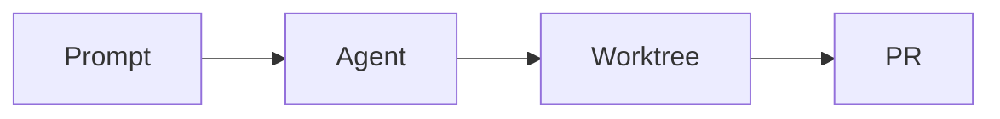

# Heading 1 with `code`

A paragraph right under a heading. It runs long enough to wrap, so the line height and the measure of the transcript column are visible. **Bold**, _italic_, **_bold italic_**, ~~strikethrough~~, `inline code`, and a [link to the docs](https://github.com/kjj6198/kkcode). A bare URL autolinks: https://github.com/kjj6198/kkcode. A pull request reference: #1.

A second paragraph, to show the gap between paragraphs.
This line follows a soft break, so it joins the paragraph above.\
This line follows a hard break, so it starts on its own line.

## Heading 2

### Heading 3

#### Heading 4

##### Heading 5

###### Heading 6

---

## Links

Each web link should start with an icon. Pull requests get the GitHub mark and a hover card, other sites their favicon, and a site without one the globe.

- A bare pull request URL, shortened to `owner/repo#n`: https://github.com/react/react/pull/31139
- A pull request with its own text: [the React Compiler ref fix](https://github.com/react/react/pull/34000)
- A pull request in another repository: https://github.com/vercel/next.js/pull/71000
- A GitHub issue, which is not a pull request: https://github.com/react/react/issues/11347
- A repository: https://github.com/react/react
- Documentation sites: [React docs](https://react.dev/reference/react/useMemo), [MDN](https://developer.mozilla.org/en-US/docs/Web/CSS/overflow-wrap) and https://tailwindcss.com/docs/overflow-wrap
- A site with no favicon: https://example.com
- A link inside **bold text: [react.dev](https://react.dev)** and one inside a sentence that wraps across lines so the icon stays with its text: [the Effect documentation on services and layers](https://effect.website/docs/requirements-management/services/)
- Not web links, so no icon: [an email](mailto:dev@example.com) and [a relative path](./README.md)

## Lists

- An unordered item
- An item with **bold** and `code`
  - A nested item
    - A third level
- An item long enough to wrap onto a second line, to check that the wrapped line lines up with the text and not with the bullet.

1. First
2. Second
   1. Nested ordered
   2. Another
3. Third

An ordered list that starts at five:

5. Five
6. Six

A task list:

- [x] A finished task
- [ ] An open task
  - [ ] A nested task

A loose list:

- A loose list item, with a blank line after it.

- The next loose item, with a paragraph inside.

  A second paragraph in the same item.

## Quotes

> A quote with a single paragraph, long enough to wrap, so the bar runs the height of both lines and stays inside the quote.

> A quote with a list:
>
> - one
> - two
>
> > A nested quote.

## Code

Inline `const answer = 42` sits on the baseline of the text around it.

```ts
import { Effect } from "effect"

/** A long line to check horizontal scrolling inside the block, instead of the whole transcript widening past the column. */
export const greet = (name: string) => Effect.succeed(`Hello, ${name}`)
```

```
A fence without a language.
```

```sh
pnpm typecheck && pnpm lint && pnpm test
```

## Table

| Left                                 | Center |  Right | Notes                                                                     |
| :----------------------------------- | :----: | -----: | ------------------------------------------------------------------------- |
| `fonts/otf/`                         |   8    | 1.2 MB | Static weights from Thin to ExtraBold                                     |
| `fonts/ttf/`                         |   8    | 1.4 MB | The same weights as TTF                                                   |
| `fonts/variable/PaperMono[wght].ttf` |   1    | 310 KB | One file covering the whole weight range, long enough to wrap in its cell |
| `fonts/webfonts/`                    |   9    | 640 KB | WOFF2 versions of all of the above                                        |

## Diagram



## Text in other scripts

這是一段繁體中文，用來檢查中英混排時的行高與字距，例如 `pnpm dev` 與 KKCode 之間的間隔。

これは日本語の段落です。行の高さと、英数字の KKCode や `git fetch` との混在を確認します。

## Edge cases

A footnote reference[^1] and an escaped \*asterisk\*. Keys render as keys: press <kbd>Cmd</kbd> + <kbd>Shift</kbd> + <kbd>P</kbd>. Other raw HTML stays text: <div>, and a tag written in prose like <Suspense> stays visible.

A very long unbroken token: aaaaaaaaaaaaaaaaaaaaaaaaaaaaaaaaaaaaaaaaaaaaaaaaaaaaaaaaaaaaaaaaaaaaaaaaaaaaaaaaaaaaaaaaaaaaaaaaaaaaaaaaaaaa

[^1]: The footnote text.
